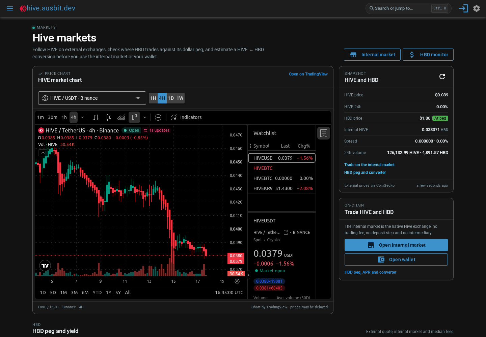

# hive.ausbit.dev

[](https://github.com/ausbitbank/hive.ausbit.dev-src/actions/workflows/ci.yml)

An open-source block explorer, wallet and toolkit for the [Hive](https://hive.io) blockchain.

hive.ausbit.dev reads directly from public Hive APIs and lets you explore blocks,
transactions, accounts, posts, governance, witnesses, markets and layer-2 data
from Hive-Engine and Magi (formerly VSC). Signing is handled by Hive Keychain or
the built-in encrypted SmartLock.

## Screenshots

Home dashboard:


Markets and HBD tools:



Wallet:


## Feature tour

| Route | What it does |
| --- | --- |
| `/` | Live block card, prices, top witnesses, trending posts and recent author posts |
| `/blocks`, `/b/:blockNum`, `/tx/:txId` | Latest blocks, block detail with grouped operations, transaction detail and raw JSON |
| `/@:username` | Account overview, activity filters, authorities, authority risk review, delegations, rewards and profile links |
| `/@:username/wallet` | Portfolio, liquid/saved/staked balances, pending actions, history, Hive-Engine tokens, Magi balances/tokens and transfers |
| `/@:username/delegations` | Incoming/outgoing Hive Power delegations, effective HP and recent delegation changes |
| `/@:username/communities` | Community directory for an account: one card per community with description, role and live stats, role/name filters, plus a merged expanded feed across the communities it belongs to |
| `/@:author/:permlink` | Content-first post page, comments, replies and native markdown composer |
| `/compose` | Local-first creator workflow: autosaved drafts, markdown editor with preview and tables, community/tags, cross-post attribution, beneficiaries, publish checklist and JSON backup |
| `/search` | Unified search for accounts, posts, tags, communities, blocks, transactions, proposals and witnesses, with facets, topic analytics, saved searches and optional AI semantic post search (HiveSense) |
| `/browse`, `/trending`, `/created`, `/hot` | Post discovery with cards/list/table layouts and filters |
| `/c/:username` | Community feed with subscriber, activity, top-author, payout and moderation insights |
| `/witnesses`, `/witness` | Witness directory, health warnings, vote concentration, feed freshness, version drift, missed-block trends, voting, proxies, vote-weight calculator and witness settings |
| `/proposals`, `/proposals/:id` | DHF proposals, funding status, votes, funding outlook, creator/receiver/topic mix and voter overlap |
| `/health`, `/nodes` | Network health and node latency/failover for Hive L1, Hive-Engine and Magi, including beacon reliability, feature coverage and Magi consensus/witness data |
| `/magi` | Read-only Magi contract viewer: metadata, timelocked updates, recent outputs, state keys and call simulation |
| `/market` | Hive internal market: order book, trades, open orders, balances, fees and limit orders |
| `/markets` | External charts, HBD peg/premium, savings APR and HIVE/HBD conversion calculator |
| `/hbd`, `/hbdstabilizer` | HBD debt ratio, haircut conditions and the HBD Stabilizer monitor |
| `/tax` | Wallet history analysis and CSV export for accounting |
| `/lightning`, `/@:account/lightning` | Lightning addresses, receive invoices and Hive/HBD → Lightning payments bridged by v4v.app |
| `/create` | Hive account creation helpers |
| `/market`, `/hbdstabilizer`, `/tax` | On-chain market, stabilizer and accounting tools |

Additional UX:

- `Ctrl K` or `/` opens search and jump.
- `f` opens the full search page; the search page supports arrow-key navigation
  and saved searches.
- `?` opens the keyboard shortcut list.
- `g` then `h/b/w/m/p/n/s/c/l` jumps to the main sections (including the composer and Lightning).
- In the composer, `Ctrl/⌘ S` saves, `Ctrl/⌘ Enter` queues the post, and
  `Ctrl/⌘ B/I/K` formats text, italicises or inserts a link.
- Back-to-top appears on long pages.
- Blocks, transactions, accounts and proposals have copy/share menus.
- The 404 page accepts direct account, tag, block, transaction and proposal searches.
- The production app registers an offline shell, manifest and RSS feed.

## Stack

- Vue 3 (Options API) and Quasar 2 / Quasar CLI (Vite)
- Pinia
- Vue Router
- `@hiveio/hive-js` for signing and legacy chain calls
- `@hiveio/keychain` for Keychain signing
- `sjcl` + `bs58` for SmartLock encrypted local key storage
- `dompurify` for sanitized post/community HTML
- Hive-Engine RPC, Magi GraphQL and CoinGecko for tokens, layer-2 data and market data
- Vitest for unit tests
- Playwright + axe-core for end-to-end and accessibility checks, with Obscura for the fast functional loop and Chromium for the full release gate

## Architecture

```
src/
  boot/          App startup: axios, Hive node selection, store, SmartLock, PWA
  components/    Feature components, including account, wallet, witness, market and ui/
  css/           Global design tokens and card/typography patterns
  layouts/       Main application layout
  mixins/        Visibility-aware timers
  pages/         Route-level pages
  router/        Routes and history-mode scroll behaviour
  services/      Chain reads, caches, API client, search, market/wallet helpers
  stores/hive/   Pinia state, queue persistence and account/global-props actions
  utils/         Time, metadata, safe HTML/URL helpers
```

### Data layer

- `src/services/api.js` is the central JSON-RPC read client with timeout, retries,
  node failover and `AbortSignal` cancellation.
- `src/services/cache.js` provides a bounded TTL cache with
  stale-while-revalidate and in-flight de-duplication.
- `src/services/chainData.js` defines cached reads for global properties,
  accounts, witnesses, posts, follow counts, median price, ticker and open orders.
- `src/mixins/timers.js` and `src/services/polling.js` pause polling while the tab
  is hidden.
- Signing/broadcast actions still use hive-js, Keychain or SmartLock.

## Requirements

- [Bun](https://bun.sh) 1.2+ (the repository ships `bun.lock`)
- Node.js 20 or newer

## Local setup

```bash
bun install
bun run dev
```

The dev server opens at <http://localhost:8080>.

## Commands

| Command | Description |
| --- | --- |
| `bun run dev` | Start the Quasar dev server |
| `bun run build` | Build the SPA into `dist/spa` and generate `feed.xml` |
| `bun run lint` | Run ESLint |
| `bun run lint:fix` | Run ESLint with fixes |
| `bun run test` | Run Vitest unit tests |
| `bun run test:watch` | Watch mode for unit tests |
| `bun run test:coverage` | Unit-test coverage report |
| `bun run test:e2e` | Fast functional E2E through Obscura (local iteration) |
| `bun run test:e2e:full` | Full Chromium E2E: axe, PWA, performance and resilience |
| `bun run test:e2e:build` | Build, then run the full Chromium E2E suite |
| `bun run test:e2e:fast:build` | Build, then run the fast Obscura suite |
| `bun run e2e:install` | Download the Obscura binary into `.tools/obscura` |
| `bun run perf` | Measure routes and refresh `docs/performance/` |
| `bun run perf:check` | Run the measured performance budgets |
| `bun run prerender` | Write metadata-only crawler snapshots into `dist/spa` |
| `bun run serve:dist` | Serve the built SPA with history fallback and compression |

## Performance

The repeatable performance dashboard lives at
[`docs/performance/README.md`](docs/performance/README.md). It records Core Web
Vitals and encoded transfer sizes for home, browse, block, post, wallet and the
internal market. `docs/performance/budgets.json` is enforced in CI by
`bun run perf:check`; the dependency breakdown is in
[`docs/performance/bundle-analysis.md`](docs/performance/bundle-analysis.md).

The crawler prerender is metadata-only: static route HTML carries title,
description, canonical, Open Graph/Twitter and JSON-LD, but never a snapshot of
the live chain body. A hard reload therefore cannot flash stale data before Vue
mounts.

## Testing

Unit tests live in `tests/unit/`. The Playwright suite lives in `e2e/` and runs
against a built production bundle served by `scripts/serve-dist.mjs`.

```bash
bun run test
bun run e2e:install     # once per machine
bun run test:e2e        # fast functional suite, ~35s
bun run test:e2e:full   # full Chromium suite, ~7 minutes
```

The **fast suite** connects Playwright to [Obscura](https://github.com/h4ckf0r0day/obscura),
a lightweight Rust/V8 headless browser with a CDP server. It runs 22 functional
tests in about 45 seconds with four workers: login simulation, queueing, the
composer and drafts, unified search, transfers, browse filters, navigation,
keyboard shortcuts, share actions and the governance/community surfaces.

The **full Chromium suite** remains the release gate: 50 tests covering axe
WCAG A/AA at desktop and mobile widths, visual/layout assertions, LCP/CLS
performance, PWA install/offline/update flows, and resilience/offline signing.
Chromium is required because Obscura has an independent layout engine, no
Performance API LCP/CLS entries, and no service-worker/offline emulation.

Playwright requires a Chromium browser once per machine for the full suite:

```bash
bunx playwright install chromium
```

CI runs `bun run test:e2e:full`; use `bun run test:e2e` for the fast local loop.
See [`docs/e2e.md`](docs/e2e.md) for the suite split and troubleshooting.

## Deployment

The production site is served by nginx from `/var/www/hive.ausbit.dev` on
`hurgenburgen`, with history-mode fallback to `index.html`. The canonical
virtual-host file is [`deploy/nginx/hive.ausbit.dev.conf`](deploy/nginx/hive.ausbit.dev.conf);
it owns the security headers, the no-trailing-slash redirect, real 404
statuses, the manifest content type and the SSI metadata shell for dynamic
routes. Keep the certbot-managed SSL lines when installing it.

```bash
./scripts/deploy.sh
```

The deploy script lints, builds, prerenders metadata-only crawler snapshots,
creates a timestamped tarball backup, uploads the build to a staging directory and
activates it with rsync. It prints the backup path and matching rollback
command:

```bash
./scripts/rollback.sh ~/hive-backups/hive.ausbit.dev-<timestamp>.tar.gz
```

Rollback first snapshots the current deployment, so a rollback is reversible.
Override `REMOTE` and `REMOTE_DIR` for another host.

## Data sources

- Public Hive API nodes: accounts, blocks, transactions, global properties,
  witnesses, proposals, market ticker and account history.
- Hive bridge/Hivemind: ranked/account posts, profiles, discussions and
  notifications.
- Hive-Engine RPC and history APIs: token balances, markets, node status and
  history.
- Magi GraphQL: balances, ledger activity, node/witness state, resource credits
  and read-only contract inspection.
- Magi token indexer: standard `magi_token` balances and token metadata.
- CoinGecko: HIVE/HBD USD prices and 24h changes.
- v4v.app: optional Hive ↔ Bitcoin Lightning bridge for Lightning addresses,
  receive invoices, fee quotes and BOLT11 decoding.
- TradingView: external price charts.

The app caches chain reads locally and falls back across configured API nodes.
Prices and third-party charts can be delayed or temporarily unavailable.

## Key authorities and security

- **Posting key**: votes, comments, follows, reblogs and notification markers.
  It cannot move funds.
- **Active key**: transfers, savings, power up/down, market orders, witness votes,
  proposal votes and authority changes.
- **Hive Keychain** keeps keys in the browser extension and asks for approval per
  action.
- **SmartLock** stores keys encrypted in local storage, keeps only the unlocked
  posting key in memory, auto-locks after an idle timeout, and asks for the
  password each time an active key is needed. The active key is never kept in
  memory.
- **Lightning payments** are normal active-key transfers to `@v4vapp`, queued
  for individual review and never auto-broadcast. Receiving and displaying a
  Lightning address needs no key. The v4v.app bridge holds keepsats, not this
  site; no key material is sent to it.
- The signing queue stores operations, not private keys, and expires after 24
  hours.
- External links use `noopener noreferrer`; post and community HTML is sanitized.

## Documentation

- [`docs/ROADMAP.md`](docs/ROADMAP.md) — current state and next priorities
- [`docs/workstreams/`](docs/workstreams/) — implementation records for W1–W27
- [`docs/performance/`](docs/performance/) — performance dashboard, budgets and bundle analysis
- [`docs/MODERNIZATION.md`](docs/MODERNIZATION.md) — 2026 migration notes

## History

The 2026 revamp modernized the abandoned Quasar 1 / Vue 2 / webpack codebase.
It was merged to `master` on 2026-11-17; the pre-revamp state is preserved as the
`archive/pre-revamp-2026-11-17` tag.

## Contributing

Pull requests, feedback and issues are welcome. Please run `bun run lint`,
`bun run test` and `bun run build` before opening a PR.

## License

Released into the public domain under the Unlicense. See [`LICENSE`](LICENSE).
