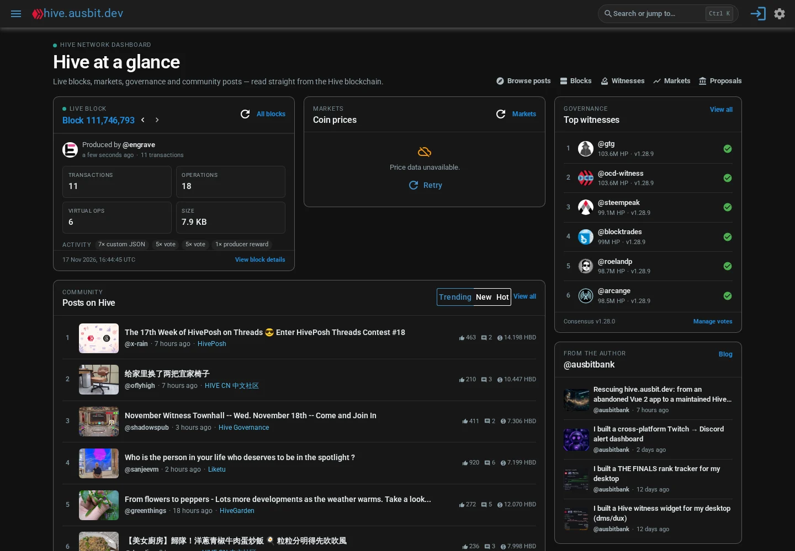
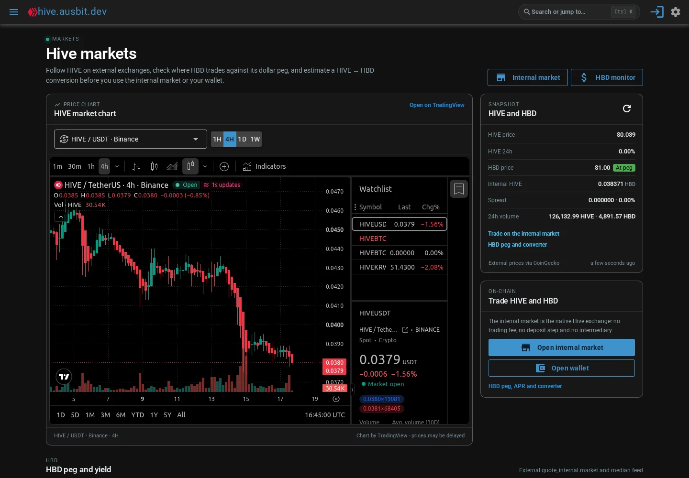
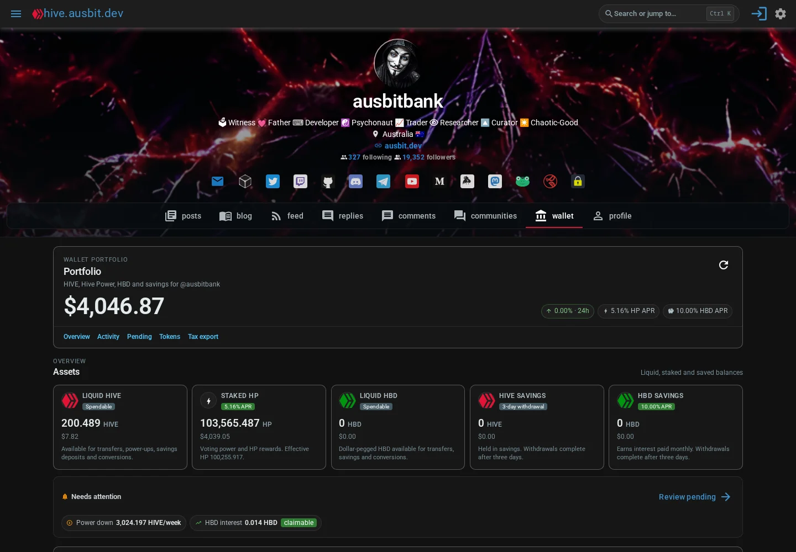

# hive.ausbit.dev

[](https://github.com/ausbitbank/hive.ausbit.dev-src/actions/workflows/ci.yml)

An open-source block explorer, wallet and toolkit for the [Hive](https://hive.io) blockchain.

hive.ausbit.dev reads directly from public Hive APIs and lets you explore blocks,
transactions, accounts, posts, short posts, governance, witnesses, markets and
layer-2 data from Hive-Engine and Magi (formerly VSC). It also includes a
customisable dashboard, a local-first composer and moderation layer, Lightning
tips and a public point-of-sale page. Signing is handled by Hive Keychain,
HiveAuth through a mobile wallet, or the built-in encrypted SmartLock.

## Screenshots

Home dashboard:



Markets and HBD tools:



Wallet:



## Feature tour

| Route | What it does |
| --- | --- |
| `/` | Customisable dashboard with draggable widgets, built-in presets, named layouts, rows/masonry tiling and layout import/export; the default shows live blocks, prices, witnesses, trending posts and community feeds |
| `/blocks`, `/b/:blockNum`, `/tx/:txId` | Latest blocks, block detail with grouped operations, transaction detail and raw JSON |
| `/@:username` | Account overview, activity filters, authorities, authority risk review, delegations, rewards and profile links |
| `/@:username/wallet` | Portfolio, liquid/saved/staked balances, pending actions, history, Hive-Engine tokens, Magi balances/tokens, transfers, optional keepsats and a local sats-received summary |
| `/@:username/wallet/:token`, `/token/:token` | Hive-Engine token detail: metadata, price, volume, balances, order book and buy/sell/cancel orders |
| `/@:username/pos` | Public Lightning point-of-sale keypad that creates a fresh invoice per sale and keeps local session totals; no login or keys required |
| `/@:username/tip` | Hive and Lightning tip page with Lightning address, QR code and receive dialog |
| `/@:username/trail` | Recent votes and curation activity carousel |
| `/@:username/followers`, `/@:username/following` | Follower and following lists with live counts |
| `/@:username/delegations` | Incoming/outgoing Hive Power delegations, effective HP and recent delegation changes |
| `/@:username/downvotes` | Received/given downvote transparency: voter, weight, target, time, relationship, conservative pattern evidence and per-voter local exclusion |
| `/@:username/communities` | Community directory for an account: one card per community with description, role and live stats, role/name filters, plus a merged expanded feed across the communities it belongs to |
| `/communities` (`/c`) | Public community browser for everyone: search all Hive communities by title, description, category or partial `hive-123` id with relevance ranking and paged matches; compare subscribers and active authors; sort by trending/subscribers/activity/newest; browse new, active and largest community shelves; and hide NSFW communities |
| `/@:author/:permlink` | Content-first post page, comments, replies and native markdown composer |
| `/shorts`, `/shorts/:format`, `/shorts/:format/@:author/:permlink` | Snaps, Waves, Threads, D.Buzz and Moments: per-format readers, composer, reactions, replies, reblogs and sats zaps |
| `/appearance` | Ten site themes including Hive Dark (default) and Hive Light, system-follow, motion, high-contrast, profile-skin visibility, calm effects, status/extras visibility and adopted palettes |
| `/themes` | Theme wall with built-in themes and published profile skins from followed accounts, filters for mode/tag/credential and recent/featured views, remixing and local palette adoption |
| `/settings/skin` | Skin Studio: palette, light/dark variants, status line, Hive Circle, badges, atmosphere, visual language, latest/pinned post, theme codes and publishing with posting authority |
| `/settings/moderation` | Local-first moderation policy: Open/Balanced/Strict/Follow-only/Custom presets, per-surface rules, distinct mute/blacklist layers, a curated list directory with explicit subscriptions and owner-only export references, overrides and versioned JSON export/import |
| `/compose` | Local-first creator workflow: autosaved drafts with history and archive, markdown/split preview, image uploads, media embeds, snippets and templates, community/tags, cross-post attribution, beneficiaries, checklists, reminders, cross-tab sync and JSON backup |
| `/search` | Unified search for accounts, posts, tags, communities, blocks, transactions, proposals, witnesses and Lightning invoices/addresses, with facets, topic analytics, saved searches and optional AI semantic post search (HiveSense) |
| `/browse`, `/trending`, `/created`, `/hot`, `/payout`, `/payout_comments`, `/muted` | Post discovery with cards/list/table layouts and filters; `/created` is the canonical new-posts surface and `/browse` redirects to it |
| `/c/:username` | Community feed with subscriber, activity, top-author, payout and moderation insights |
| `/witnesses`, `/witness` | Witness directory, health warnings, vote concentration, feed freshness, version drift, missed-block trends, voting, proxies, vote-weight calculator and witness settings |
| `/proposals`, `/dao`, `/proposals/:id` | DHF proposals, funding status, votes, funding outlook, creator/receiver/topic mix and voter overlap |
| `/health`, `/nodes` | Network health and node latency/failover for Hive L1, Hive-Engine and Magi, including beacon reliability, feature coverage and Magi consensus/witness data |
| `/magi` | Read-only Magi contract viewer: metadata, timelocked updates, recent outputs, state keys and call simulation |
| `/market` | Hive internal market: order book, trades, open orders, balances, fees and limit orders |
| `/markets` | External charts, HBD peg/premium, savings APR, HIVE/HBD conversion calculator and a live sats quote |
| `/hbd`, `/hbdstabilizer` | HBD debt ratio, haircut conditions and the HBD Stabilizer monitor |
| `/tax` | Wallet history analysis and CSV export for accounting, including sats and fee columns |
| `/lightning`, `/@:account/lightning` | Lightning addresses, receive invoices, payment links and Hive/HBD → Lightning payments bridged by v4v.app; the wallet adds the opt-in keepsats panel and zap buttons appear on posts |
| `/create` | Hive account creation helpers |

Additional UX:

- The home dashboard is local-first: add, remove, resize and reorder widgets,
  switch built-in presets, auto-optimise, save named layouts and import/export a
  layout code. The default layout works without signing in.
- The whole site uses a semantic theme token layer. Themes never rearrange
  content, and profile skins are scoped to the author's profile, blog and post
  pages with a visible “Skin by” badge and a one-click “Hide skins” action.
  Skins from muted or negative-reputation authors are withheld unless the
  viewer explicitly opts in.
- Moderation is local-first: the base policy, per-item overrides and per-voter
  exclusions are stored in the browser and exportable as versioned JSON, while
  list subscriptions are explicit posting-key follows. There is no hidden global
  ban list.
- Profile skins can carry a static status, a six-account Hive Circle, curated
  PeakD/HiveBuzz badges, a cover/collage atmosphere and a latest/pinned post.
  Badges are cached, fail open and are only marked verified when they match the
  issuer allowlist. The Profile Shelf never loads on post pages or feeds.
- Theme codes, remixing and “Use this palette” are local-first. Importing a code
  always previews before applying; adopting a palette never changes the
  author's on-chain skin.
- `Ctrl K` or `/` opens search and jump.
- `f` opens the full search page; the search page supports arrow-key navigation
  and saved searches.
- `?` opens the keyboard shortcut list.
- `g` then `h/b/w/m/p/n/s/c/l` jumps to the main sections (including the composer and Lightning).
- In the composer, `Ctrl/⌘ S` saves, `Ctrl/⌘ Enter` queues the post, and
  `Ctrl/⌘ B/I/K` formats text, italicises or inserts a link.
- Back-to-top appears on long pages.
- Blocks, transactions, accounts and proposals have copy/share menus.
- The 404 page accepts direct account, tag, block, transaction and proposal searches.
- The production app registers an offline shell, manifest and RSS feed.

## Stack

- Vue 3 (Options API) and Quasar 2 / Quasar CLI (Vite)
- Pinia and Vue Router
- `hive-tx` for signing, keys, memos and legacy chain calls
- `@hiveio/keychain` for Keychain signing
- `@ecency/render-helper` + `dompurify` for sanitized post/community HTML
- `sjcl` + `bs58` for SmartLock encrypted local key storage
- `@noble/hashes` + Web Crypto for the HiveAuth client-side AES envelope
- `dayjs`, `linkify-it`, `uqr` and `vue-json-pretty` for dates, link detection, QR codes and raw JSON
- Hive-Engine RPC, Magi GraphQL/API and CoinGecko for tokens, layer-2 data and market data
- Vitest for unit tests
- Playwright + axe-core for end-to-end and accessibility checks, with Obscura for the fast functional loop and Chromium for the full release gate

## Architecture

```
src/
  boot/          App startup: Hive node selection, store, SmartLock, prefetch, theme and PWA
  components/    Feature components, including account, wallet, witness, market, dashboard, moderation, shortForm, lightning and ui/
  css/           Global design tokens and card/typography patterns
  layouts/       Main application layout
  mixins/        Visibility-aware timers and moderation helpers
  pages/         Route-level pages
  router/        Routes and history-mode scroll behaviour
  services/      Chain reads, caches, API client, search, moderation, dashboard, Lightning, short-form, publishing and market/wallet helpers
  stores/hive/   Pinia state, queue persistence, account/global-props actions and dashboard layout
  stores/        Appearance and moderation stores
  themes/        Theme manifests, strict profile-skin schema, tokens and metadata helpers
  utils/         Time, metadata, markdown, safe HTML/URL and embed helpers
```

### Data layer

- `src/services/api.js` is the central JSON-RPC read client with timeout, retries,
  node failover and `AbortSignal` cancellation.
- `src/services/cache.js` provides a bounded TTL cache with
  stale-while-revalidate and in-flight de-duplication.
- `src/services/chainData.js` defines cached reads for global properties,
  accounts, witnesses, posts, follow counts, median price, ticker and open orders.
- `src/services/moderationPolicy.js` and `moderationContent.js` make moderation
  decisions locally; policy, dashboard layouts, drafts and appearance
  preferences persist in the browser, while explicit list subscriptions are
  normal posting-key follows.
- `src/services/shortForm.js` holds the five microblog format profiles and
  classifiers shared by the readers, composer, queue and tests.
- `src/services/lightning.js` and `v4vapp.js` own the bridge reads, quotes and
  payment paths; writes become normal queued active-key actions.
- `src/mixins/timers.js` and `src/services/polling.js` pause polling while the tab
  is hidden.
- Signing/broadcast actions use hive-tx, Keychain, SmartLock or HiveAuth.

## Requirements

- [Bun](https://bun.sh) 1.2+ (the repository ships `bun.lock`)
- Node.js 20 or newer

## Local setup

```bash
bun install
bun run dev
```

The dev server opens at <http://localhost:8080>.

## Commands

| Command | Description |
| --- | --- |
| `bun run dev` | Start the Quasar dev server |
| `bun run build` | Build the SPA into `dist/spa`, mark the entry script for Cloudflare Rocket Loader, and generate `feed.xml` and the home snapshot |
| `bun run lint` | Run ESLint and the theme-token scanner |
| `bun run lint:fix` | Run ESLint with fixes |
| `bun run test` | Run Vitest unit tests |
| `bun run test:watch` | Watch mode for unit tests |
| `bun run test:coverage` | Unit-test coverage report |
| `bun run test:e2e` | Fast functional E2E through Obscura (local iteration) |
| `bun run test:e2e:full` | Full Chromium E2E: axe, PWA, performance and resilience |
| `bun run test:e2e:build` | Build, then run the full Chromium E2E suite |
| `bun run test:e2e:fast:build` | Build, then run the fast Obscura suite |
| `bun run e2e:install` | Download the Obscura binary into `.tools/obscura` |
| `bun run perf` | Measure routes and refresh `docs/performance/` |
| `bun run perf:check` | Run the measured performance budgets |
| `bun run prerender` | Write metadata-only crawler snapshots into `dist/spa` |
| `bun run serve:dist` | Serve the built SPA with history fallback and compression |
| `bun run nginx:ips` | Refresh the trusted Cloudflare real-IP ranges |
| `bun run v4vapp:contract` | Run the read-only v4v.app bridge contract check |
| `bun run icons:subset` | Regenerate the subsetted Material Icons font |
| `bun run devlog` | Collect, screenshot, draft and validate a development blog post |

## Performance

The repeatable performance dashboard lives at
[`docs/performance/README.md`](docs/performance/README.md). It records Core Web
Vitals and encoded transfer sizes for home, browse, block, post, wallet, the
internal market, compose and search. `docs/performance/budgets.json` is enforced
in CI by `bun run perf:check`; the dependency breakdown is in
[`docs/performance/bundle-analysis.md`](docs/performance/bundle-analysis.md).

The crawler prerender is metadata-only: static route HTML carries title,
description, canonical, Open Graph/Twitter and JSON-LD, but never a snapshot of
the live chain body. A hard reload therefore cannot flash stale data before Vue
mounts.

## Testing

Unit tests live in `tests/unit/`. The Playwright suite lives in `e2e/` and runs
against a built production bundle served by `scripts/serve-dist.mjs`.

```bash
bun run test
bun run e2e:install     # once per machine
bun run test:e2e        # fast functional suite
bun run test:e2e:full   # full Chromium suite
```

The **fast suite** connects Playwright to [Obscura](https://github.com/h4ckf0r0day/obscura),
a lightweight Rust/V8 headless browser with a CDP server. It runs more than 100
functional tests with four workers: login simulation, queueing, the composer and
drafts, unified search, transfers, browse filters, infinite scroll, navigation,
keyboard shortcuts, share actions, governance and community surfaces, moderation
and downvotes, themes and skins, dashboard layouts, connections, badges,
keepsats, Lightning search and payments, POS and market sats quotes.

The **full Chromium suite** remains the release gate: it runs the complete spec
set, adding axe WCAG A/AA at desktop and mobile widths, visual/layout assertions,
LCP/CLS performance, PWA install/offline/update flows, wallet CSV export,
Lightning state coverage, and resilience/offline signing.
Chromium is required because Obscura has an independent layout engine, no
Performance API LCP/CLS entries, and no service-worker/offline emulation.

Playwright requires a Chromium browser once per machine for the full suite:

```bash
bunx playwright install chromium
```

CI runs `bun run test:e2e:full` and `bun run perf:check`; a separate daily
workflow runs the read-only v4v.app contract check outside the PR gate. Use
`bun run test:e2e` for the fast local loop.
See [`docs/e2e.md`](docs/e2e.md) for the suite split and troubleshooting.

## Deployment

The production site is served by nginx from `/var/www/hive.ausbit.dev` on
`hurgenburgen`, with history-mode fallback to `index.html`. The canonical
virtual-host file is [`deploy/nginx/hive.ausbit.dev.conf`](deploy/nginx/hive.ausbit.dev.conf);
it owns the security headers, the no-trailing-slash redirect, real 404
statuses, the manifest content type and the SSI metadata shell for dynamic
routes. Keep the certbot-managed SSL lines when installing it.

Cloudflare sits in front of the origin. A metadata Worker
([`deploy/cloudflare/metadata-worker.mjs`](deploy/cloudflare/metadata-worker.mjs),
bound in [`wrangler.jsonc`](wrangler.jsonc)) rewrites link-preview metadata for
account and post URLs and serves the appearance, themes and settings shells at
the edge. Deploy it separately with `npx wrangler deploy`; the SPA deploy script
does not touch it. Edge traffic-rule plans and the traffic analysis behind them
live in [`deploy/cloudflare/RULES.md`](deploy/cloudflare/RULES.md) and
[`docs/analytics-review.md`](docs/analytics-review.md).

```bash
./scripts/deploy.sh
```

The deploy script lints, builds, prerenders metadata-only crawler snapshots,
creates a timestamped tarball backup, uploads the build to a staging directory and
activates it with rsync. It prints the backup path and matching rollback
command:

```bash
./scripts/rollback.sh ~/hive-backups/hive.ausbit.dev-<timestamp>.tar.gz
```

Rollback first snapshots the current deployment, so a rollback is reversible.
Override `REMOTE` and `REMOTE_DIR` for another host.

Activation deliberately keeps the previous builds' content-hashed `/assets/`
files for `KEEP_DAYS` days (default 45) and prunes only older files. A tab that
was opened before a deploy can therefore still load the lazy chunks its old
bundle asks for. In front of that, the vhost serves HTML shells `no-cache` and
`/assets/` as `immutable`, and `src/boot/chunkRecovery.js` turns any remaining
chunk-load failure into one automatic reload instead of a dead navigation. If
Cloudflare is caching HTML (a Cache Everything rule or a fixed Browser Cache
TTL), set it back to "Respect Existing Headers": a pinned shell defeats all of
the above.

The build stamps a unique id into `sw.js` and `version.json`
(`scripts/stamp-build.mjs`), which is what makes the existing "Update
available" prompt fire for normal deploys rather than only when `sw.js` is
edited.

The origin also trusts Cloudflare's `CF-Connecting-IP` header so access logs
record real visitor IPs instead of edge IPs. The trusted ranges live in
`deploy/nginx/cloudflare-realip.conf` and are refreshed from Cloudflare with
`bun run nginx:ips`. Apply the real-IP and JSON access-log block with
`bash scripts/apply-nginx-remote.sh hurgenburgen dry-run` first; the same script
with `apply` backs up the live config, tests it and reloads nginx. See
[`docs/analytics-review.md`](docs/analytics-review.md) for the traffic analysis
that prompted it.

## Data sources

- Public Hive API nodes: accounts, blocks, transactions, global properties,
  witnesses, proposals, market ticker and account history.
- Hive bridge/Hivemind: ranked/account posts, profiles, discussions and
  notifications.
- Hive-Engine RPC and history APIs: token balances, markets, node status and
  history.
- Magi GraphQL: balances, ledger activity, node/witness state, resource credits
  and read-only contract inspection.
- Magi token indexer: standard `magi_token` balances and token metadata.
- CoinGecko: HIVE/HBD USD prices and 24h changes.
- v4v.app: optional Hive ↔ Bitcoin Lightning bridge for Lightning addresses,
  receive invoices, keepsats, point-of-sale invoices, fee quotes and BOLT11
  decoding.
- TradingView: external price charts.

The app caches chain reads locally and falls back across configured API nodes.
Prices and third-party charts can be delayed or temporarily unavailable.

## Key authorities and security

- **Posting key**: votes, comments, follows, reblogs and notification markers.
  It cannot move funds.
- **Active key**: transfers, savings, power up/down, market orders, witness votes,
  proposal votes and authority changes.
- **Hive Keychain** keeps keys in the browser extension and asks for approval per
  action.
- **HiveAuth** shows a QR code or deep link; the user approves in a mobile wallet
  (Hive Keychain Mobile or HiveAuth Mobile) and keys never enter this origin.
  Each action needs phone approval; the queue sends HiveAuth actions one at a
  time and waits for that approval. The HAS relay sees the account, app name and
  timing, never keys or plaintext operations.
- **SmartLock** stores keys encrypted in local storage, keeps only the unlocked
  posting key in memory, auto-locks after an idle timeout, and asks for the
  password each time an active key is needed. The active key is never kept in
  memory.
- **Lightning payments** are normal active-key transfers to `@v4vapp`, queued
  for individual review and never auto-broadcast. Receiving, tips and POS
  invoices need no key. Keepsats are custodial at v4v.app; the wallet's opt-in
  panel keeps the session token in memory only, and deposits, conversions and
  payments are queued active-key actions. No key material is sent to the bridge.
- **Moderation is local-first.** The site ships no global ban list. Curated list
  subscriptions are explicit posting-key follows, and policy, overrides and
  per-voter exclusions stay in the browser.
- The signing queue stores operations, not private keys, and expires after 24
  hours.
- External links use `noopener noreferrer`; post and community HTML is sanitized.

## Documentation

- [`docs/ROADMAP.md`](docs/ROADMAP.md) — current state and next priorities
- [`docs/workstreams/`](docs/workstreams/) — implementation records for W1–W73
- [`docs/SECURITY.md`](docs/SECURITY.md) — response headers and the client-side key model
- [`docs/e2e.md`](docs/e2e.md) — Obscura/Chromium suite split and troubleshooting
- [`docs/performance/`](docs/performance/) — performance dashboard, budgets and bundle analysis
- [`docs/integrations/v4vapp-lightning.md`](docs/integrations/v4vapp-lightning.md) — Lightning bridge research and integration contract
- [`deploy/cloudflare/`](deploy/cloudflare/) — metadata Worker, edge-rule plans and verification
- [`docs/DEVLOG.md`](docs/DEVLOG.md) — development-blog pipeline, editorial rules and screenshot recipes
- [`docs/MODERNIZATION.md`](docs/MODERNIZATION.md) — 2026 migration notes

## History

The 2026 revamp modernized the abandoned Quasar 1 / Vue 2 / webpack codebase.
It was merged to `master` on 2026-11-17; the pre-revamp state is preserved as the
`archive/pre-revamp-2026-11-17` tag.

## Contributing

Pull requests, feedback and issues are welcome. Please run `bun run lint`,
`bun run test` and `bun run build` before opening a PR.

## License

Released into the public domain under the Unlicense. See [`LICENSE`](LICENSE).
