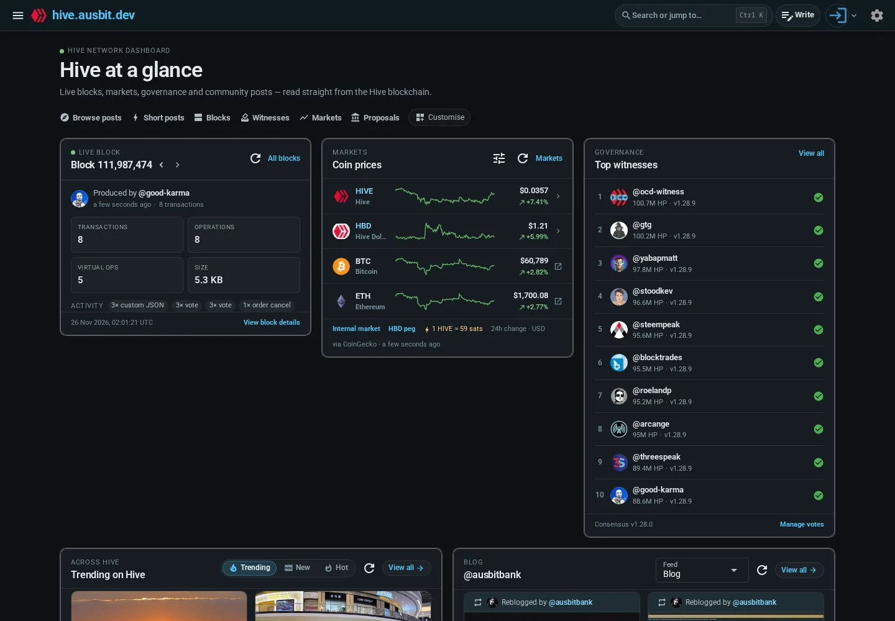
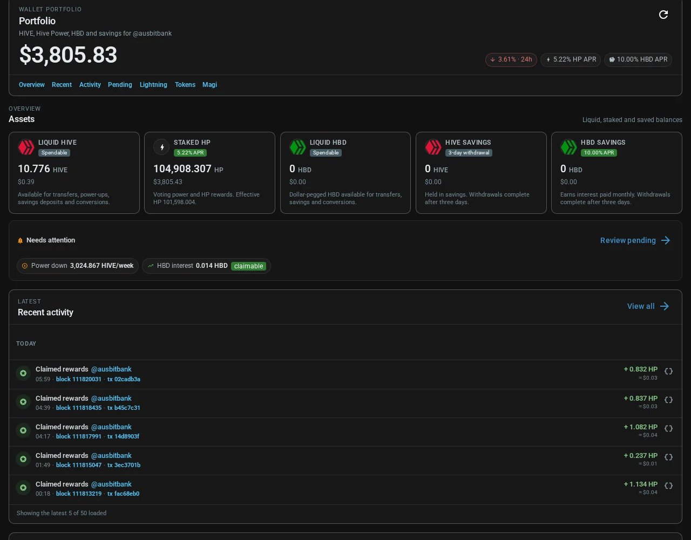
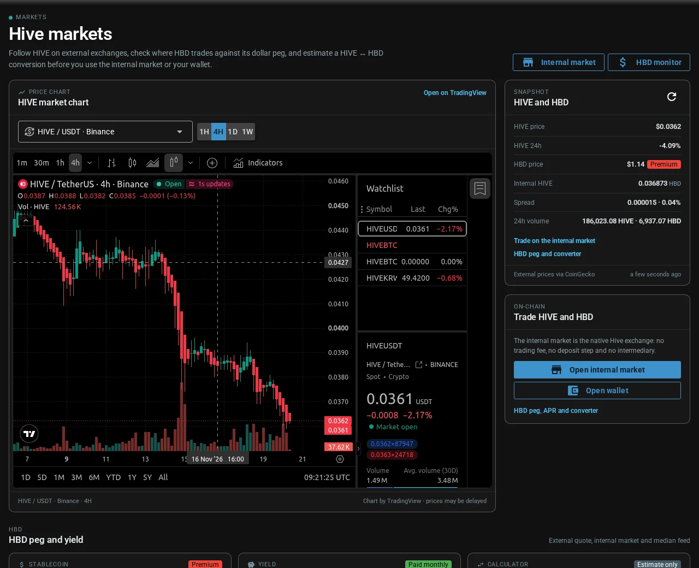
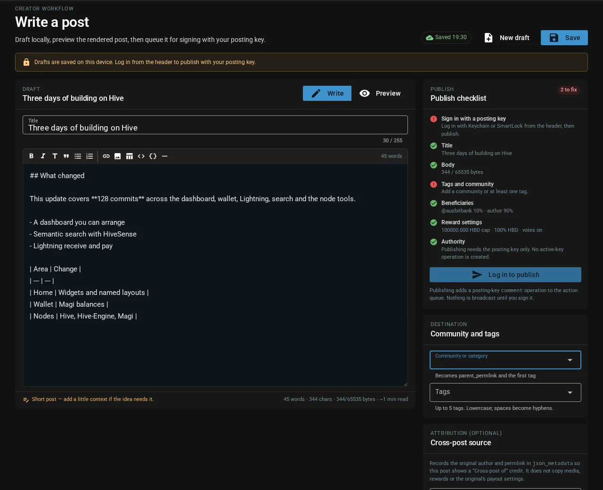
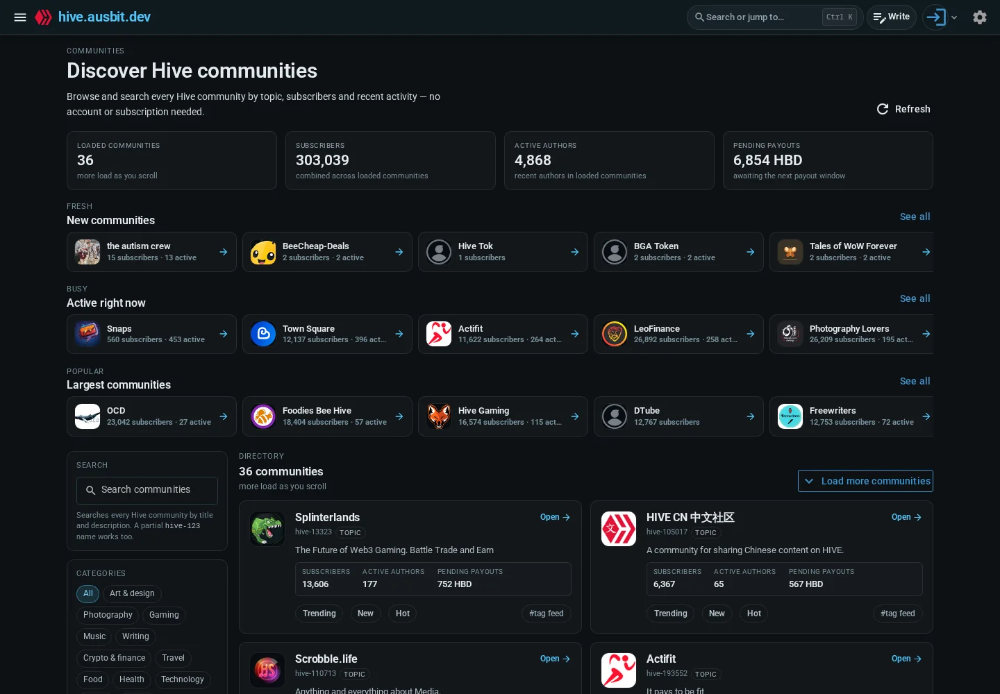
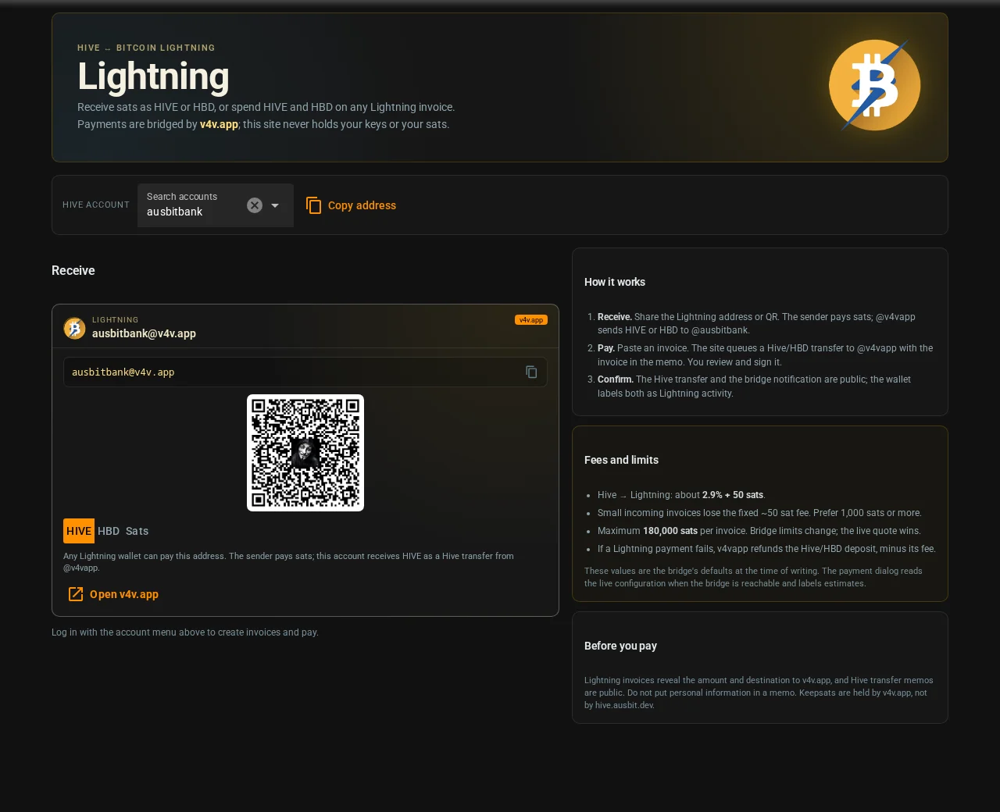
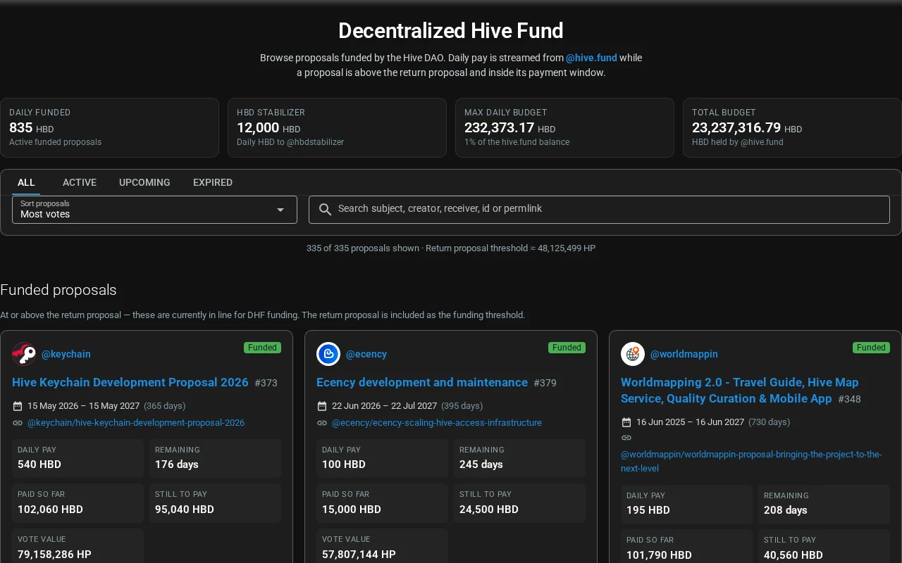
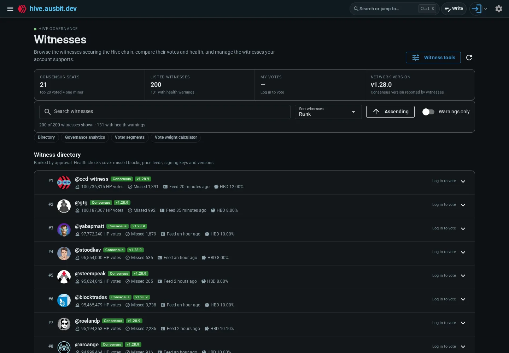
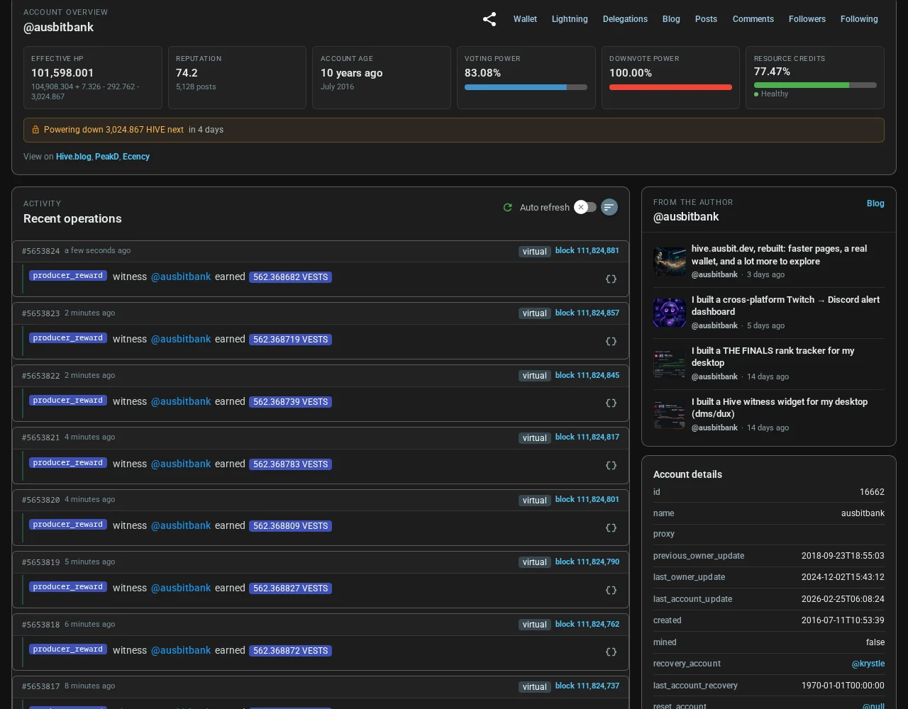
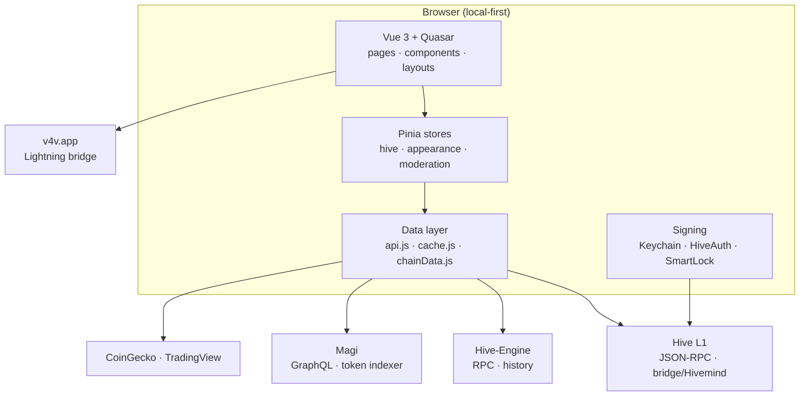

<p align="center">
  <a href="https://banksia.io">
    
  </a>
</p>

<h1 align="center">Banksia</h1>

<p align="center">
  <strong>Explore, trade and create on Hive — from one fast, local-first app.</strong><br>
  Blocks, accounts, posts, governance, markets, wallets and layer-2 data, read directly from public Hive APIs.
</p>

<p align="center">
  <a href="https://banksia.io"></a>
  <a href="https://github.com/ausbitbank/hive.ausbit.dev-src/actions/workflows/ci.yml"></a>
  <a href="LICENSE"></a>
  <a href="https://hive.io"></a>
  <a href="https://vuejs.org"></a>
  <a href="https://quasar.dev"></a>
</p>

<p align="center">
  <a href="https://banksia.io"></a>
</p>

**Banksia** is an open-source block explorer, wallet and creator toolkit
for the [Hive](https://hive.io) blockchain. It reads from public Hive APIs, so
most of the app works without an account. When you do sign in, keys stay under
your control through Hive Keychain, HiveAuth on a mobile wallet, or the built-in
encrypted SmartLock.

There is no site-wide ban list, no site-controlled feed ranking and no account
required to explore. Your dashboard, drafts, theme, moderation choices and saved
searches live in your browser.

<p align="center">
  <a href="#feature-tour">Features</a> ·
  <a href="#screenshots">Screenshots</a> ·
  <a href="#stack">Stack</a> ·
  <a href="#architecture">Architecture</a> ·
  <a href="#local-setup">Quick start</a> ·
  <a href="#testing">Testing</a> ·
  <a href="#deployment">Deployment</a> ·
  <a href="#documentation">Docs</a>
</p>

## What is inside

| | |
| --- | --- |
| **Explore the chain**<br>Blocks, transactions, accounts, authorities, delegations, followers, downvote transparency and a unified search across nine categories, from accounts to Lightning invoices. | **Own your wallet**<br>HIVE, HBD, Hive Power, savings, Hive-Engine tokens, Magi balances, transfers and a tax-friendly CSV export. |
| **Create and publish**<br>A local-first composer with drafts, history, media uploads, embeds, snippets, templates, checklists and cross-posting. | **Find your people**<br>Public community discovery, per-account community feeds, short-form readers, curation trails and Lightning tips. |
| **Trade and earn**<br>The internal Hive market, external charts, HBD peg tools, witness and proposal governance, and sats quotes. | **Sign your way**<br>Keychain, HiveAuth or SmartLock. Posting and active actions stay separated, reviewed and queued. |
| **Make it yours**<br>Ten built-in themes, draggable dashboard layouts, profile skins, badges and a theme wall. | **Moderate locally**<br>Open, Balanced, Strict, Follow-only or custom moderation policy with explainable decisions, overrides and portable JSON. |

## Screenshots

| Wallet | Markets |
| --- | --- |
|  |  |

| Composer | Communities |
| --- | --- |
|  |  |

| Lightning | DHF proposals |
| --- | --- |
|  |  |

| Witnesses | Account |
| --- | --- |
|  |  |

## Feature tour

### Explore and search

| Route | What it does |
| --- | --- |
| `/` | Customisable dashboard with draggable widgets, built-in presets, named layouts, rows/masonry tiling and layout import/export; the default shows live blocks, prices, witnesses, trending posts, an account blog and the HiveDevs community feed |
| `/blocks`, `/b/:blockNum`, `/tx/:txId` | Latest blocks, block detail with grouped operations, transaction detail and raw JSON |
| `/@:username` | Account overview, activity filters, authorities, authority risk review, delegations, rewards and profile links |
| `/@:username/delegations` | Incoming/outgoing Hive Power delegations, effective HP and recent delegation changes |
| `/@:username/downvotes` | Received/given downvote transparency: voter, weight, target, time, relationship, conservative pattern evidence and per-voter local exclusion |
| `/@:username/trail` | Recent votes and curation activity carousel |
| `/@:username/followers`, `/@:username/following` | Follower and following lists with live counts |
| `/@:username/posts`, `/@:username/blog`, `/@:username/feed`, `/@:username/replies`, `/@:username/comments` | Account-scoped post, blog, feed, reply and comment views |
| `/search` | Unified search for accounts, posts, tags, communities, blocks, transactions, proposals, witnesses and Lightning invoices/addresses, with facets, topic analytics, saved searches and optional AI semantic post search (HiveSense) |

### Read, write and discover

| Route | What it does |
| --- | --- |
| `/@:author/:permlink` | Content-first post page, comments, replies and a native markdown composer |
| `/shorts`, `/shorts/:format`, `/shorts/:format/@:author/:permlink` | Snaps, Waves, Threads, D.Buzz and Moments: per-format readers, composer, reactions, replies, reblogs and sats zaps |
| `/compose` | Local-first creator workflow: autosaved drafts with history and archive, markdown/split preview, image uploads, media embeds, snippets and templates, community/tags, cross-post attribution, beneficiaries, checklists, reminders, cross-tab sync and JSON backup |
| `/communities` (`/c`) | Public community browser: search all Hive communities by title, description, category or partial `hive-123` id with relevance ranking and paged matches; compare subscribers and active authors; sort by trending/subscribers/activity/newest; browse new, active and largest shelves; hide NSFW communities |
| `/c/:username` | Community feed with subscriber, activity, top-author, payout and moderation insights |
| `/@:username/communities` | Community directory for an account: one card per community with description, role and live stats, role/name filters, plus a merged expanded feed across the communities it belongs to |
| `/browse`, `/trending`, `/created`, `/hot`, `/payout`, `/payout_comments`, `/muted` | Post discovery with cards/list/table layouts and filters; `/created` is the canonical new-posts surface and `/browse` redirects to it |

### Wallet, markets and Lightning

| Route | What it does |
| --- | --- |
| `/@:username/wallet`, `/@:username/transfers` | Portfolio, liquid/saved/staked balances, pending actions, history, Hive-Engine tokens, Magi balances/tokens, transfers, a tax-friendly CSV export, optional keepsats and a local sats-received summary |
| `/@:username/wallet/:token`, `/token/:token` | Hive-Engine token detail: metadata, price, volume, balances, order book and buy/sell/cancel orders |
| `/@:username/pos` | Public Lightning point-of-sale keypad that creates a fresh invoice per sale and keeps local session totals; no login or keys required |
| `/@:username/tip` | Hive and Lightning tip page with Lightning address, QR code and receive dialog |
| `/market` | Hive internal market: order book, trades, open orders, balances, fees and limit orders |
| `/markets` | External charts, HBD peg/premium, savings APR, HIVE/HBD conversion calculator and a live sats quote |
| `/hbd`, `/hbdstabilizer` | HBD debt ratio, haircut conditions and the HBD Stabilizer monitor |
| `/lightning`, `/@:account/lightning` | Lightning addresses, receive invoices, payment links and Hive/HBD → Lightning payments bridged by v4v.app; the wallet adds the opt-in keepsats panel and zap buttons appear on posts |

### Governance, network and tools

| Route | What it does |
| --- | --- |
| `/witnesses`, `/witness` | Witness directory, health warnings, vote concentration, feed freshness, version drift, missed-block trends, voting, proxies, vote-weight calculator and witness settings |
| `/proposals`, `/dao`, `/proposals/:id` | DHF proposals, funding status, votes, funding outlook, creator/receiver/topic mix and voter overlap |
| `/health`, `/nodes` | Network health and node latency/failover for Hive L1, Hive-Engine and Magi, including beacon reliability, feature coverage and Magi consensus/witness data |
| `/magi` | Read-only Magi contract viewer: metadata, timelocked updates, recent outputs, state keys and call simulation |
| `/create` | Hive account creation helpers |

### Appearance and trust

| Route | What it does |
| --- | --- |
| `/appearance` | Ten site themes including Hive Dark (default) and Hive Light, system-follow, motion, high-contrast, profile-skin visibility, calm effects, status/extras visibility and adopted palettes |
| `/themes` | Theme wall with built-in themes and published profile skins from followed accounts, filters for mode/tag/credential and recent/featured views, remixing and local palette adoption |
| `/settings/skin` | Skin Studio: palette, light/dark variants, status line, Hive Circle, badges, atmosphere, visual language, latest/pinned post, theme codes and publishing with posting authority |
| `/settings/moderation` | Local-first moderation policy: Open/Balanced/Strict/Follow-only/Custom presets, per-surface rules, distinct mute/blacklist layers, a curated list directory with explicit subscriptions and owner-only export references, overrides and versioned JSON export/import |
| `/about` | Product story, the Banksia name and mark, design principles, license and source links |

### Keyboard and workflow

- `Ctrl K` or `/` opens search and jump; `f` opens the full search page, which
  supports arrow-key navigation and saved searches.
- `?` opens the keyboard shortcut list.
- `g` then `h/b/w/m/p/n/s/c/l` jumps to the main sections, including the
  composer and Lightning.
- In the composer, `Ctrl/⌘ S` saves, `Ctrl/⌘ Enter` queues the post, and
  `Ctrl/⌘ B/I/K` formats text, italicises or inserts a link.
- Back-to-top appears on long pages; blocks, transactions, accounts and
  proposals have copy/share menus.
- The 404 page accepts direct account, tag, block, transaction and proposal
  searches.
- The production app registers an offline shell, manifest and RSS feed.

## Design principles

- **Local-first.** Dashboard layouts, drafts, appearance, saved searches and
  moderation policy persist in the browser. Explicit list subscriptions are
  normal posting-key follows; there is no hidden global ban list.
- **Keys stay yours.** SmartLock keeps encrypted keys in local storage, unlocks
  only the posting key in memory, auto-locks after idle and asks for the password
  before any active-key action. The active key is never kept in memory.
- **Explainable moderation.** Every decision names its source and offers an
  override where the app is allowed to. Reputation-gated features can be
  reviewed instead of silently hidden.
- **Scoped skins.** Profile skins never rearrange content, are bounded to the
  author's profile, blog and post pages, carry a visible “Skin by” badge, and
  can be hidden at any time.
- **Resilient by default.** Every network path has a timeout, a fallback and a
  stale/error state. A dead API node must not become a dead page.
- **Accessible.** One page-level `h1`, semantic controls, visible focus,
  reduced-motion support and no horizontal overflow at 390px.

## Stack

| Layer | Technology |
| --- | --- |
| UI | Vue 3 (Options API), Quasar 2 and Quasar CLI (Vite) |
| State and routing | Pinia and Vue Router |
| Chain and signing | `hive-tx`, `@hiveio/keychain`, `@noble/hashes`, Web Crypto |
| Content | `@ecency/render-helper` and `dompurify` for sanitized post/community HTML |
| Local security | `sjcl` and `bs58` for SmartLock encrypted local key storage |
| Utilities | `dayjs`, `linkify-it`, `uqr` and `vue-json-pretty` for dates, links, QR codes and raw JSON |
| Data | Hive JSON-RPC, Hive bridge/Hivemind, Hive-Engine RPC, Magi GraphQL/API, CoinGecko and v4v.app |
| Tests | Vitest for unit tests; Playwright + axe-core for E2E and accessibility; Obscura for the fast functional loop and Chromium for the release gate |

## Architecture



<details>
<summary><strong>Source layout</strong></summary>

```
src/
  assets/        Small local SVGs used by empty and error states
  boot/          App startup: Hive node selection, store, SmartLock, prefetch, theme and PWA
  components/    Feature components, including account, wallet, witness, market,
                 dashboard, moderation, shortForm, lightning and ui/
  composables/   Reusable composition helpers such as the account widget loader
  css/           Global design tokens and card/typography patterns
  data/          Static curated data such as badge credential allowlists
  layouts/       Main application layout
  mixins/        Visibility-aware timers and moderation helpers
  pages/         Route-level pages
  router/        Routes and history-mode scroll behaviour
  services/      Chain reads, caches, API client, search, moderation, dashboard,
                 Lightning, short-form, publishing and market/wallet helpers
  shims/         Browser compatibility shims
  stores/hive/   Pinia state, queue persistence, account/global-props actions and dashboard layout
  stores/        Appearance and moderation stores
  themes/        Theme manifests, strict profile-skin schema, tokens and metadata helpers
  utils/         Time, metadata, markdown, safe HTML/URL and embed helpers
```

### Data layer

- `src/services/api.js` is the central JSON-RPC read client with timeout, retries,
  node failover and `AbortSignal` cancellation.
- `src/services/cache.js` provides a bounded TTL cache with
  stale-while-revalidate and in-flight de-duplication.
- `src/services/chainData.js` defines cached reads for global properties,
  accounts, witnesses, posts, follow counts, median price, ticker and open orders.
- `src/services/moderationPolicy.js` and `moderationContent.js` make moderation
  decisions locally; policy, dashboard layouts, drafts and appearance
  preferences persist in the browser, while explicit list subscriptions are
  normal posting-key follows.
- `src/services/shortForm.js` holds the five microblog format profiles and
  classifiers shared by the readers, composer, queue and tests.
- `src/services/lightning.js` and `v4vapp.js` own the bridge reads, quotes and
  payment paths; writes become normal queued active-key actions.
- `src/mixins/timers.js` and `src/services/polling.js` pause polling while the tab
  is hidden.
- Signing and broadcast actions use hive-tx, Keychain, SmartLock or HiveAuth.

</details>

## Signing and authority

| Method | Where the keys live | Best for |
| --- | --- | --- |
| **Hive Keychain** | Browser extension; approval per action | Desktop users who already use Keychain |
| **HiveAuth** | Mobile wallet (Keychain Mobile or HiveAuth Mobile); keys never enter this origin | Phone approval and QR/deep-link login |
| **SmartLock** | Encrypted in this browser with SJCL (AES-CCM, PBKDF2, 310,000 iterations) | Users who want a built-in local signer |

- **Posting key**: votes, comments, follows, reblogs, notification markers and
  profile-skin publishing. It cannot move funds.
- **Active key**: transfers, savings, power up/down, market orders, witness
  votes, proposal votes and authority changes.
- HiveAuth shows a QR code or deep link and approves each action on the phone.
  The queue sends HiveAuth actions one at a time and waits for that approval.
- SmartLock keeps only the unlocked posting key in memory, auto-locks after an
  idle timeout, and asks for the password each time an active key is needed.
- Lightning payments are normal active-key transfers to `@v4vapp`, queued for
  individual review and never auto-broadcast. Receiving, tips and POS invoices
  need no key.
- The signing queue stores operations, not private keys, and expires after 24
  hours.
- External links use `noopener noreferrer`; post and community HTML is sanitized.

See [`docs/SECURITY.md`](docs/SECURITY.md) for the full key model, CSP and header
policy, and [`SECURITY.md`](SECURITY.md) for the private reporting process.

## Requirements

- [Bun](https://bun.sh) 1.2 or newer (the repository ships `bun.lock`; the
  current lockfile was generated with Bun 1.4.4)
- Node.js 24.15+ (LTS), Node 22.22.2+ or Node 26+ (required by the test and
  build toolchain; `.nvmrc` selects Node 24)

## Local setup

```bash
bun install
bun run dev
```

The dev server opens at <http://localhost:8080>.

## Commands

| Command | Description |
| --- | --- |
| `bun run dev` | Start the Quasar dev server |
| `bun run build` | Build the SPA into `dist/spa`, apply the Cloudflare compatibility shim, stamp `sw.js`/`version.json`, and generate `feed.xml` and the home snapshot |
| `bun run lint` | Run ESLint and the theme-token scanner |
| `bun run lint:fix` | Run ESLint with fixes |
| `bun run test` | Run Vitest unit tests |
| `bun run test:watch` | Watch mode for unit tests |
| `bun run test:coverage` | Unit-test coverage report |
| `bun run test:e2e` | Fast functional E2E through Obscura (local iteration) |
| `bun run test:e2e:full` | Full Chromium E2E: axe, PWA, performance and resilience |
| `bun run test:e2e:build` | Build, then run the full Chromium E2E suite |
| `bun run test:e2e:fast:build` | Build, then run the fast Obscura suite |
| `bun run e2e:install` | Download the Obscura binary into `.tools/obscura` |
| `bun run perf` | Measure routes and refresh `docs/performance/` |
| `bun run perf:check` | Run the measured performance budgets |
| `bun run prerender` | Write metadata-only crawler snapshots into `dist/spa` |
| `bun run serve:dist` | Serve the built SPA with history fallback and compression |
| `bun run verify:deploy` | Verify the deployed site's routes, headers and metadata |
| `bun run nginx:ips` | Refresh the trusted Cloudflare real-IP ranges |
| `bun run v4vapp:contract` | Run the read-only v4v.app bridge contract check |
| `bun run icons:subset` | Regenerate the subsetted Material Icons font |
| `bun run devlog` | Collect, screenshot, draft and validate a development blog post |

## Testing

Unit tests live in `tests/unit/`; the Playwright suite lives in `e2e/` and runs
against a built production bundle served by `scripts/serve-dist.mjs`. The repo
currently has more than 1,500 unit tests and over 100 functional E2E checks.

```bash
bun run test
bun run e2e:install     # once per machine
bun run test:e2e        # fast functional suite
bun run test:e2e:full   # full Chromium suite
```

The **fast suite** connects Playwright to [Obscura](https://github.com/h4ckf0r0day/obscura),
a lightweight Rust/V8 headless browser with a CDP server. It runs the functional
tests with four workers: login simulation, queueing, the composer and drafts,
unified search, transfers, browse filters, infinite scroll, navigation, keyboard
shortcuts, share actions, governance and community surfaces, moderation and
downvotes, themes and skins, dashboard layouts, connections, badges, keepsats,
Lightning search and payments, POS and market sats quotes.

The **full Chromium suite** remains the release gate: it runs the complete spec
set, adding axe WCAG A/AA at desktop and mobile widths, visual/layout assertions,
LCP/CLS performance, PWA install/offline/update flows, wallet CSV export,
Lightning state coverage, and resilience/offline signing. Chromium is required
because Obscura has an independent layout engine, no Performance API LCP/CLS
entries, and no service-worker/offline emulation.

```bash
bunx playwright install chromium
```

CI runs `bun run test:e2e:full` and `bun run perf:check`. A separate daily
workflow runs the read-only v4v.app contract check outside the PR gate. See
[`docs/e2e.md`](docs/e2e.md) for the suite split and troubleshooting.

## Performance

The repeatable performance dashboard lives at
[`docs/performance/README.md`](docs/performance/README.md). It records Core Web
Vitals and encoded transfer sizes for home, browse, block, post, wallet, the
internal market, compose and search. `docs/performance/budgets.json` is enforced
in CI by `bun run perf:check`; the dependency breakdown is in
[`docs/performance/bundle-analysis.md`](docs/performance/bundle-analysis.md).

The crawler prerender is metadata-only: static route HTML carries title,
description, canonical, Open Graph/Twitter and JSON-LD, but never a snapshot of
the live chain body. A hard reload therefore cannot flash stale data before Vue
mounts.

## Deployment

The production site is served by nginx from `/var/www/banksia.io` on
`hurgenburgen`, with history-mode fallback to `index.html`. The canonical
virtual-host file is [`deploy/nginx/banksia.io.conf`](deploy/nginx/banksia.io.conf);
it owns the security headers, the no-trailing-slash redirect, real 404
statuses, the manifest content type and the SSI metadata shell for dynamic
routes. The same vhost also lists `www.banksia.io` and the legacy
`hive.ausbit.dev`, so old links keep working; canonical and Open Graph URLs always
point at `banksia.io`. Install the vhost, then run
`certbot --nginx -d banksia.io -d www.banksia.io -d hive.ausbit.dev` once on the
host so the certificate covers all three names.

Cloudflare sits in front of the origin. A metadata Worker
([`deploy/cloudflare/metadata-worker.mjs`](deploy/cloudflare/metadata-worker.mjs),
bound in [`wrangler.jsonc`](wrangler.jsonc)) rewrites link-preview metadata for
account and post URLs, serves the appearance, themes, settings and Lightning
shells at the edge, and accepts CSP violation reports on `/csp-report`. Deploy
it separately with `npx wrangler@4 deploy`; the SPA deploy script
does not touch it. Edge traffic-rule plans and the traffic analysis behind them
live in [`deploy/cloudflare/RULES.md`](deploy/cloudflare/RULES.md) and
[`docs/analytics-review.md`](docs/analytics-review.md).

```bash
./scripts/deploy.sh
```

The deploy script lints, builds, prerenders metadata-only crawler snapshots,
creates a timestamped tarball backup, uploads the build to a staging directory and
activates it with rsync. On the first run it seeds `/var/www/banksia.io` from the
old `/var/www/hive.ausbit.dev` build if the new path is empty, so the domain switch
is zero-downtime. Before activation it runs
[`scripts/check-nginx-host.sh`](scripts/check-nginx-host.sh), which aborts if the one
shared vhost stops serving both `banksia.io` and `hive.ausbit.dev`, if the docroot
moves, if the `/about` route is missing, or if a second enabled vhost claims either
host. SPA deploys never write nginx config. It prints the backup path and matching
rollback command:

```bash
./scripts/rollback.sh ~/banksia-backups/banksia.io-<timestamp>.tar.gz
```

Rollback first snapshots the current deployment, so a rollback is reversible.
Override `REMOTE` and `REMOTE_DIR` for another host.

Activation deliberately keeps the previous builds' content-hashed `/assets/`
files for `KEEP_DAYS` days (default 45) and prunes only older files. A tab that
was opened before a deploy can therefore still load the lazy chunks its old
bundle asks for. In front of that, the vhost serves HTML shells `no-cache` and
`/assets/` as `immutable`, and `src/boot/chunkRecovery.js` turns any remaining
chunk-load failure into one automatic reload instead of a dead navigation. If
Cloudflare is caching HTML (a Cache Everything rule or a fixed Browser Cache
TTL), set it back to "Respect Existing Headers": a pinned shell defeats all of
the above.

The build stamps a unique id into `sw.js` and `version.json`
(`scripts/stamp-build.mjs`), which is what makes the existing "Update
available" prompt fire for normal deploys rather than only when `sw.js` is
edited.

### banksia.io cutover

1. Point `banksia.io` and `www.banksia.io` at Cloudflare and add the zone.
2. Install the vhost, enable it and disable the old symlink so only one server
   block owns the names:
   ```bash
   scp deploy/nginx/banksia.io.conf hurgenburgen:/tmp/
   ssh hurgenburgen 'sudo cp /tmp/banksia.io.conf /etc/nginx/sites-available/banksia.io'
   ssh hurgenburgen 'sudo ln -sf /etc/nginx/sites-available/banksia.io /etc/nginx/sites-enabled/banksia.io'
   ssh hurgenburgen 'sudo rm -f /etc/nginx/sites-enabled/hive.ausbit.dev'
   ssh hurgenburgen 'sudo nginx -t && sudo systemctl reload nginx'
   ```
3. Issue or expand the certificate so the same vhost covers all three names:
   ```bash
   ssh hurgenburgen 'sudo certbot --nginx -d banksia.io -d www.banksia.io -d hive.ausbit.dev'
   ```
   Keep the certbot-managed `ssl_certificate` lines it writes.
4. Deploy the SPA with `./scripts/deploy.sh`. The first run seeds
   `/var/www/banksia.io` from the old build and verifies both hosts.
5. Deploy the metadata Worker with `npx wrangler@4 deploy`, verify the new routes,
   then delete the old `hive-metadata` Worker.
6. Confirm `https://banksia.io` and `https://hive.ausbit.dev` both return the app;
   canonical, Open Graph and JSON-LD URLs should always be `banksia.io`.
7. Ask v4v.app to add `https://banksia.io` to its CORS allowlist and to register
   the `banksia` app name. The legacy `hive.ausbit.dev` origin remains allowlisted,
   so Lightning keeps working there during the transition.

The origin also trusts Cloudflare's `CF-Connecting-IP` header so access logs
record real visitor IPs instead of edge IPs. The trusted ranges live in
`deploy/nginx/cloudflare-realip.conf` and are refreshed from Cloudflare with
`bun run nginx:ips`. Apply the real-IP and JSON access-log block with
`bash scripts/apply-nginx-remote.sh hurgenburgen dry-run` first; the same script
with `apply` backs up the live config, tests it and reloads nginx. See
[`docs/analytics-review.md`](docs/analytics-review.md) for the traffic analysis
that prompted it.

## Data sources

- Public Hive API nodes: accounts, blocks, transactions, global properties,
  witnesses, proposals, market ticker and account history.
- Hive bridge/Hivemind: ranked/account posts, profiles, discussions and
  notifications.
- Hive-Engine RPC and history APIs: token balances, markets, node status and
  history.
- Magi GraphQL: balances, ledger activity, node/witness state, resource credits
  and read-only contract inspection.
- Magi token indexer: standard `magi_token` balances and token metadata.
- CoinGecko: HIVE/HBD USD prices and 24h changes.
- v4v.app: optional Hive ↔ Bitcoin Lightning bridge for Lightning addresses,
  receive invoices, keepsats, point-of-sale invoices, fee quotes and BOLT11
  decoding.
- TradingView: external price charts.

The app caches chain reads locally and falls back across configured API nodes.
Prices and third-party charts can be delayed or temporarily unavailable.

## Documentation

- [`docs/ROADMAP.md`](docs/ROADMAP.md) — current open work and next priorities
- [`docs/workstreams/README.md`](docs/workstreams/README.md) — index of every W1–W79 implementation record
- [`docs/SECURITY.md`](docs/SECURITY.md) — response headers and the client-side key model
- [`docs/e2e.md`](docs/e2e.md) — Obscura/Chromium suite split and troubleshooting
- [`docs/performance/`](docs/performance/) — performance dashboard, budgets and bundle analysis
- [`docs/integrations/v4vapp-lightning.md`](docs/integrations/v4vapp-lightning.md) — Lightning bridge research and integration contract
- [`deploy/cloudflare/`](deploy/cloudflare/) — metadata Worker, edge-rule plans and verification
- [`docs/DEVLOG.md`](docs/DEVLOG.md) — development-blog pipeline, editorial rules and screenshot recipes
- [`docs/MODERNIZATION.md`](docs/MODERNIZATION.md) — 2026 migration notes
- [`CONTRIBUTING.md`](CONTRIBUTING.md) — setup, checks and review expectations
- [`CODE_OF_CONDUCT.md`](CODE_OF_CONDUCT.md) — community standards

## History

The 2026 revamp modernized the abandoned Quasar 1 / Vue 2 / webpack codebase.
It was merged to `master` on 2026-11-17; the pre-revamp state is preserved as the
`archive/pre-revamp-2026-11-17` tag. The app was renamed from `hive.ausbit.dev`
to **Banksia** at `banksia.io` on 2026-11-26; the old subdomain remains a legacy
host that serves the same build.

## Contributing

Pull requests, feedback and issues are welcome. Please run `bun run lint`,
`bun run test` and `bun run build` before opening a PR, and read
[`CONTRIBUTING.md`](CONTRIBUTING.md) for the full checklist and commit style.

Security issues should go through the private process in [`SECURITY.md`](SECURITY.md),
not a public issue.

## License

Released into the public domain under the Unlicense. See [`LICENSE`](LICENSE).
