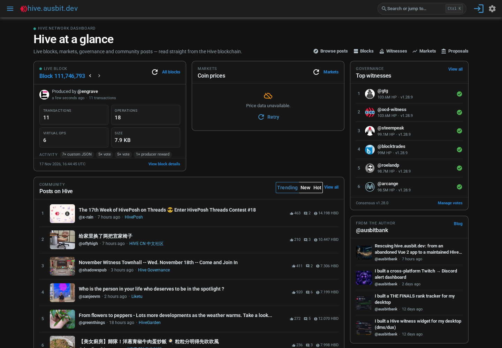
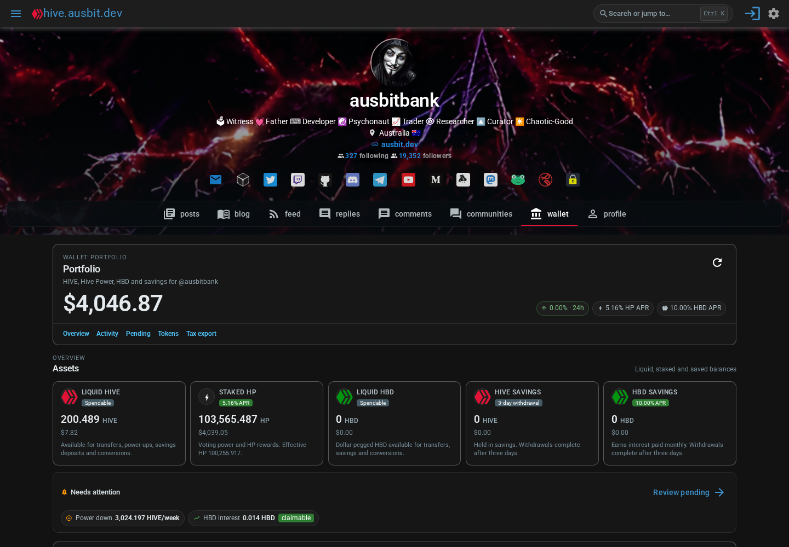

# hive.ausbit.dev

[](https://github.com/ausbitbank/hive.ausbit.dev-src/actions/workflows/ci.yml)

An open-source block explorer, wallet and toolkit for the [Hive](https://hive.io) blockchain.

hive.ausbit.dev reads directly from public Hive APIs and lets you explore blocks,
transactions, accounts, posts, governance, witnesses, markets and Hive-Engine
tokens. Signing is handled by Hive Keychain or the built-in encrypted SmartLock.

## Screenshots

Home dashboard:



Markets and HBD tools:


Wallet:



## Feature tour

| Route | What it does |
| --- | --- |
| `/` | Live block card, prices, top witnesses, trending posts and recent author posts |
| `/blocks`, `/b/:blockNum`, `/tx/:txId` | Latest blocks, block detail with grouped operations, transaction detail and raw JSON |
| `/@:username` | Account overview, activity filters, authorities, delegations, rewards and profile links |
| `/@:username/wallet` | Portfolio, liquid/saved/staked balances, pending actions, history, Hive-Engine tokens and transfers |
| `/@:author/:permlink` | Content-first post page, comments, replies and native markdown composer |
| `/browse`, `/trending`, `/created`, `/hot` | Post discovery with cards/list/table layouts and filters |
| `/witnesses`, `/witness` | Witness directory, health warnings, voting, proxies, vote-weight calculator and witness settings |
| `/proposals`, `/proposals/:id` | DHF proposals, funding status, votes and voting |
| `/health`, `/nodes` | Network health, witness participation, HBD backing and API node latency/failover |
| `/market` | Hive internal market: order book, trades, open orders, balances, fees and limit orders |
| `/markets` | External charts, HBD peg/premium, savings APR and HIVE/HBD conversion calculator |
| `/hbd`, `/hbdstabilizer` | HBD debt ratio, haircut conditions and the HBD Stabilizer monitor |
| `/tax` | Wallet history analysis and CSV export for accounting |
| `/create` | Hive account creation helpers |
| `/market`, `/hbdstabilizer`, `/tax` | On-chain market, stabilizer and accounting tools |

Additional UX:

- `Ctrl K` or `/` opens search and jump.
- `?` opens the keyboard shortcut list.
- `g` then `h/b/w/m/p/n/s` jumps to the main sections.
- Back-to-top appears on long pages.
- Blocks, transactions, accounts and proposals have copy/share menus.
- The 404 page accepts direct account, tag, block, transaction and proposal searches.
- The production app registers an offline shell, manifest and RSS feed.

## Stack

- Vue 3 (Options API) and Quasar 2 / Quasar CLI (Vite)
- Pinia
- Vue Router
- `@hiveio/hive-js` for signing and legacy chain calls
- `@hiveio/keychain` for Keychain signing
- `sjcl` + `bs58` for SmartLock encrypted local key storage
- `dompurify` for sanitized post/community HTML
- Hive-Engine Hive RPC and CoinGecko for token and market data
- Vitest for unit tests
- Playwright + axe-core for end-to-end and accessibility checks

## Architecture

```
src/
  boot/          App startup: axios, Hive node selection, store, SmartLock, PWA
  components/    Feature components, including account, wallet, witness, market and ui/
  css/           Global design tokens and card/typography patterns
  layouts/       Main application layout
  mixins/        Visibility-aware timers
  pages/         Route-level pages
  router/        Routes and history-mode scroll behaviour
  services/      Chain reads, caches, API client, search, market/wallet helpers
  stores/hive/   Pinia state, queue persistence and account/global-props actions
  utils/         Time, metadata, safe HTML/URL helpers
```

### Data layer

- `src/services/api.js` is the central JSON-RPC read client with timeout, retries,
  node failover and `AbortSignal` cancellation.
- `src/services/cache.js` provides a bounded TTL cache with
  stale-while-revalidate and in-flight de-duplication.
- `src/services/chainData.js` defines cached reads for global properties,
  accounts, witnesses, posts, follow counts, median price, ticker and open orders.
- `src/mixins/timers.js` and `src/services/polling.js` pause polling while the tab
  is hidden.
- Signing/broadcast actions still use hive-js, Keychain or SmartLock.

## Requirements

- [Bun](https://bun.sh) 1.2+ (the repository ships `bun.lock`)
- Node.js 20 or newer

## Local setup

```bash
bun install
bun run dev
```

The dev server opens at <http://localhost:8080>.

## Commands

| Command | Description |
| --- | --- |
| `bun run dev` | Start the Quasar dev server |
| `bun run build` | Build the SPA into `dist/spa` and generate `feed.xml` |
| `bun run lint` | Run ESLint |
| `bun run lint:fix` | Run ESLint with fixes |
| `bun run test` | Run Vitest unit tests |
| `bun run test:watch` | Watch mode for unit tests |
| `bun run test:coverage` | Unit-test coverage report |
| `bun run test:e2e` | Run Playwright E2E and axe checks against `dist/spa` |
| `bun run test:e2e:build` | Build, then run the E2E/axe suite |
| `bun run perf` | Measure routes and refresh `docs/performance/` |
| `bun run perf:check` | Run the measured performance budgets |
| `bun run prerender` | Write metadata-only crawler snapshots into `dist/spa` |
| `bun run serve:dist` | Serve the built SPA with history fallback and compression |

## Performance

The repeatable performance dashboard lives at
[`docs/performance/README.md`](docs/performance/README.md). It records Core Web
Vitals and encoded transfer sizes for home, browse, block, post, wallet and the
internal market. `docs/performance/budgets.json` is enforced in CI by
`bun run perf:check`; the dependency breakdown is in
[`docs/performance/bundle-analysis.md`](docs/performance/bundle-analysis.md).

The crawler prerender is metadata-only: static route HTML carries title,
description, canonical, Open Graph/Twitter and JSON-LD, but never a snapshot of
the live chain body. A hard reload therefore cannot flash stale data before Vue
mounts.

## Testing

Unit tests live in `tests/unit/`. The Playwright suite lives in `e2e/` and runs
against a built production bundle served by `scripts/serve-dist.mjs`.

```bash
bun run test
bun run test:e2e:build
```

The E2E suite covers login simulation, comment queueing, proposal voting, wallet
transfers, browse filters, queue controls, 404 search, keyboard shortcuts,
back-to-top, share actions, the offline shell/manifest/feed, and axe WCAG A/AA
checks for key routes at desktop and mobile widths.

Playwright requires a Chromium browser once per machine:

```bash
bunx playwright install chromium
```

## Deployment

The production site is served by nginx from `/var/www/hive.ausbit.dev` on
`hurgenburgen`, with history-mode fallback to `index.html`.

```bash
./scripts/deploy.sh
```

The deploy script lints, builds, prerenders metadata-only crawler snapshots,
creates a timestamped tarball backup, uploads the build to a staging directory and
activates it with rsync. It prints the backup path and matching rollback
command:

```bash
./scripts/rollback.sh ~/hive-backups/hive.ausbit.dev-<timestamp>.tar.gz
```

Rollback first snapshots the current deployment, so a rollback is reversible.
Override `REMOTE` and `REMOTE_DIR` for another host.

## Data sources

- Public Hive API nodes: accounts, blocks, transactions, global properties,
  witnesses, proposals, market ticker and account history.
- Hive bridge/Hivemind: ranked/account posts, profiles, discussions and
  notifications.
- Hive-Engine RPC and history APIs: token balances, markets and history.
- CoinGecko: HIVE/HBD USD prices and 24h changes.
- TradingView: external price charts.

The app caches chain reads locally and falls back across configured API nodes.
Prices and third-party charts can be delayed or temporarily unavailable.

## Key authorities and security

- **Posting key**: votes, comments, follows, reblogs and notification markers.
  It cannot move funds.
- **Active key**: transfers, savings, power up/down, market orders, witness votes,
  proposal votes and authority changes.
- **Hive Keychain** keeps keys in the browser extension and asks for approval per
  action.
- **SmartLock** stores keys encrypted in local storage, keeps only the unlocked
  posting key in memory, auto-locks after an idle timeout, and asks for the
  password each time an active key is needed. The active key is never kept in
  memory.
- The signing queue stores operations, not private keys, and expires after 24
  hours.
- External links use `noopener noreferrer`; post and community HTML is sanitized.

## Documentation

- [`docs/ROADMAP.md`](docs/ROADMAP.md) — current state and next priorities
- [`docs/workstreams/`](docs/workstreams/) — implementation records for W1–W27
- [`docs/performance/`](docs/performance/) — performance dashboard, budgets and bundle analysis
- [`docs/MODERNIZATION.md`](docs/MODERNIZATION.md) — 2026 migration notes

## History

The 2026 revamp modernized the abandoned Quasar 1 / Vue 2 / webpack codebase.
It was merged to `master` on 2026-11-17; the pre-revamp state is preserved as the
`archive/pre-revamp-2026-11-17` tag.

## Contributing

Pull requests, feedback and issues are welcome. Please run `bun run lint`,
`bun run test` and `bun run build` before opening a PR.

## License

Released into the public domain under the Unlicense. See [`LICENSE`](LICENSE).
