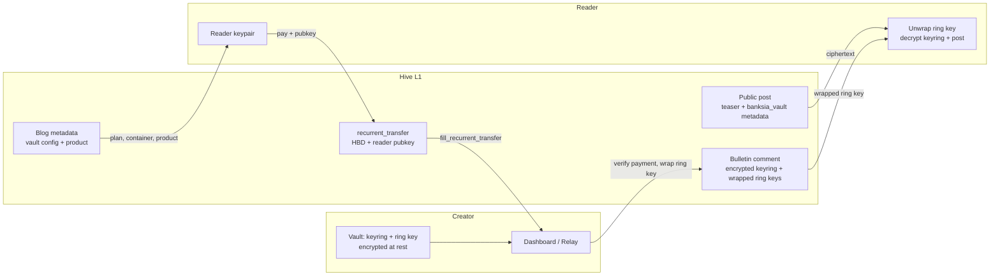
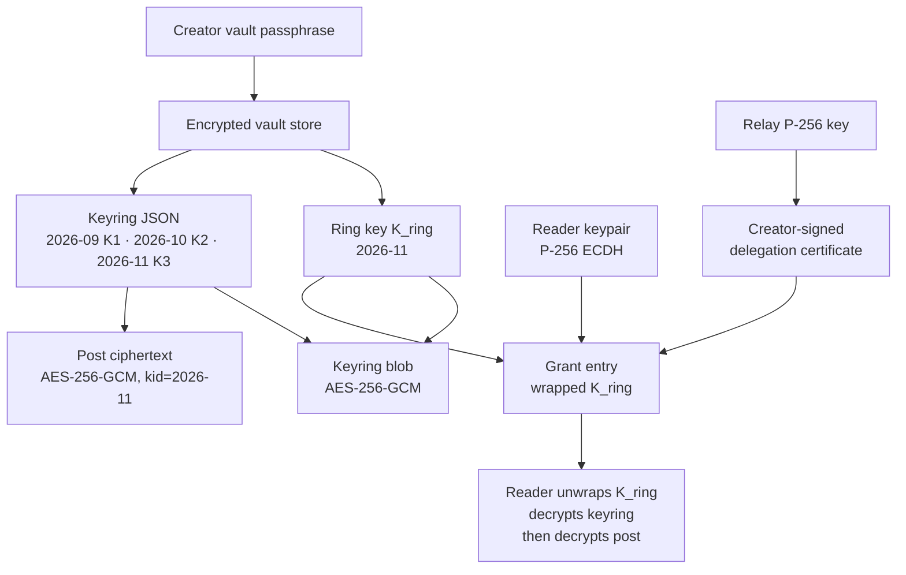
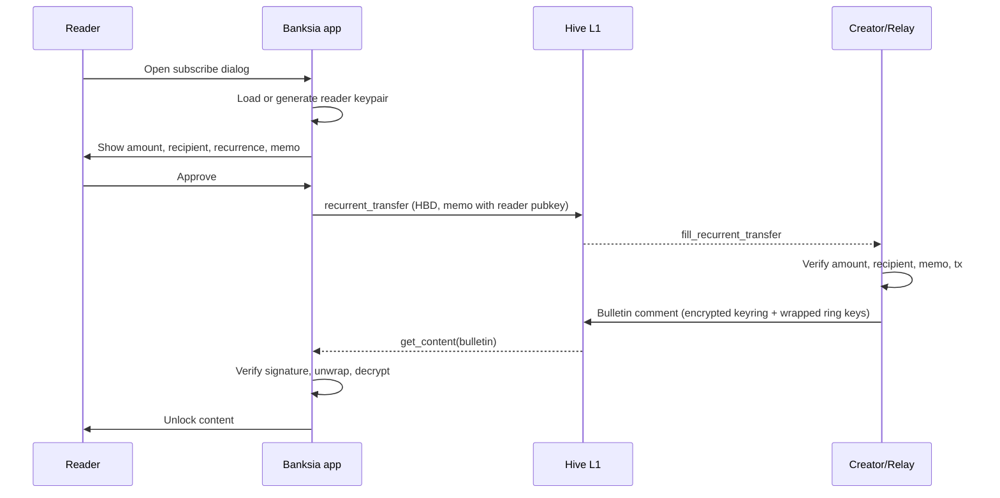

# Members-only content for Banksia blogs

Research and design proposal · 2026-11-27 · status: **research only, no code shipped**

This document answers one question: how should Banksia let a blog owner sell
monthly access to a locked section (or a whole post) without giving up the
local-first, non-custodial model, and without settling for the memo-key
encryption that every Hive paywall has used so far?

The short answer is a protocol called **Banksia Vault**:

- native HBD subscriptions through `recurrent_transfer` (HF28 allows many
  subscriptions per account);
- a per-blog **keyring** of random AES-256-GCM content keys, rotated monthly,
  unlocked by a per-period **ring key**;
- a **reader key** generated in the browser and wrapped per subscriber with
  P-256 ECDH + HKDF + AES-GCM (WebCrypto, no new dependency);
- a signed **grant bulletin** published on chain as a comment, so a reader can
  find and unwrap their key without a server, an account, or a memo;
- an optional relay that can issue grants while the creator is offline, with a
  delegated key that cannot post as the creator or move funds;
- the public teaser stays a normal Hive post, so search, RSS, Open Graph and
  other Hive frontends keep working.

The rest of the document explains why, what exists, what the competition does,
and what to build first.

**Contents:** 0 Executive summary · 1 Opportunity and constraints · 2 What exists
today · 3 Competition and method research · 4 The design space · 5 Banksia Vault
architecture · 6 Product design · 7 Creative extensions · 8 Risks · 9
Implementation plan · 10 Open decisions · 11 Sources · 12 Caveats · Appendix:
Glossary.

---

## 0. Executive summary

### The recommendation

| Layer | Recommendation | Why |
| --- | --- | --- |
| Payment | HBD `recurrent_transfer`, 730-hour recurrence, 12 executions; one-time `transfer` for a single month | Native, feeless, cancelable, already used by PeakD and mes.fm; no card, no chargebacks, no custody |
| Discovery/interop | Publish the membership as a Hive Open Market product (`content_type: "product"`, `subscription: 1`) | Any HOM frontend can list it; Banksia's existing `/pay` flow already understands it |
| Entitlement | Creator-signed grant, derived from a verified on-chain payment | Never trust a user-writable `premium: true` flag; the grant is the capability |
| Content protection | Client-side AES-256-GCM encryption of the locked payload | Public chain + UI-only paywall is not a paywall |
| Key distribution | Per-reader wrapping of the period ring key, with a public encrypted keyring blob | No server, no memo-key limit, constant-size grants, scalable to hundreds of readers, easy to fetch |
| Automation | Self-sovereign first; self-hosted relay second; hosted relay optional; threshold/Lit later | Keeps the default non-custodial, gives creators a path to instant grants |
| Reader onboarding | Pay from any self-custody Hive wallet (Keychain, HiveAuth, SmartLock); the payment memo carries the reader public key; no Banksia account required. Custodial-wallet readers can use a claim code or Lightning/fiat | Removes the biggest conversion killer without pretending every wallet can sign |
| Archive | Keyring includes past period content keys; full archive by default, configurable | New subscribers get value immediately; revocation is handled by rotating forward |
| Fee | 0% platform fee; optional 1% "support Banksia"; monetise themes, custom domains, relay hosting | Substack 10%, Patreon 10%, Memberful $49 + 4.9%, InLeo 1–5% — 0% is a wedge |
| Standard | Publish `banksia.vault@1` with JSON schemas and test vectors | If other Hive frontends adopt it, Banksia owns the paywall standard the way HOM owns marketplace posts |

### What makes it different from InLeo Creator Subscriptions

InLeo is the only serious Hive-native competitor today. It charges a fixed
5 HBD/month, requires INLEO Premium for creators, takes 1–5%, stores encrypted
blogs as comments, and decrypts through an INLEO proxy. That is a good product,
but it is a platform product.

Banksia Vault is the opposite shape:

- **Any price**, not 5 HBD.
- **Any blog**, including a custom domain, not a feed inside one app.
- **No platform balance**: the subscriber pays the creator directly; there is
  no claim step and no platform custody.
- **No premium gate** for creators.
- **Encrypted sections inside otherwise public posts**, not only whole encrypted
  comments.
- **Reader-held keys**: Banksia cannot read the content, and the content is
  still decryptable if Banksia disappears.
- **Open protocol**: PeakD, Ecency, 3Speak or a self-hosted client can implement
  it without asking.

### What makes it different from Substack / Ghost / Patreon

Those products gate on a server. The plaintext exists on their infrastructure,
and access is a database row. That is simpler and works, but it requires
custody, a payment processor, chargeback handling, and trust in the platform.
Banksia Vault encrypts before publication and never has the plaintext. The
trade-off is key management and a weaker "instant revoke" story; both are
manageable and are covered in §5.7 and §8.

### Recommended MVP (one workstream, W89)

1. Creator enables Vault in `/settings/blog`, generates a keyring and ring key, sets a price
   in HBD, publishes a HOM product post and a hidden grant container.
2. Composer gets a "Members only" toggle and a lock-from-here marker.
3. On publish, the premium payload is encrypted and stored in
   `json_metadata.banksia_vault`; the public body keeps the teaser and marker.
4. Reader without a grant sees a paywall card. Reader with a grant sees the
   content inline, with a "Licensed to @reader" watermark.
5. Subscribe queues a `recurrent_transfer` (or a one-time `transfer`) whose memo
   carries the reader public key. The creator dashboard (or an optional relay)
   verifies the payment and publishes a grant bulletin.
6. Reader unlocks without reloading; access expires with the grant; cancellation
   stops the next period's grant.
7. Text only at launch. Encrypted media, tiers, trials, gifts, annual passes and
   pay-per-post are phase 2.

---

## 1. The opportunity and the constraints

Banksia already has most of the pieces:

- an on-chain blog at `<account>.banksia.io` with themes, sections, portfolio and
  a Hive Open Market shop (W84–W87);
- on-chain blog settings written with the posting key, with no server-side
  config database;
- a local-first signing stack (Keychain, HiveAuth, SmartLock) that never keeps
  the active key in memory;
- a `/pay` page that derives the seller, amount and memo from chain data and
  queues a reviewed transfer or recurrent transfer;
- key generation and public-key validation (`/join/keys`, `/create`);
- Lightning via v4v.app and a keepsats model;
- a public-API-only SPA with no key custody server.

The missing piece is explicitly listed in the roadmap: **premium entitlements**
(W84 remaining work), with the instruction "verify entitlement from chain state,
never from the user-writable blog object."

The constraints that make this hard are also the constraints that make the
design interesting:

1. **The chain is public.** A UI-only paywall is bypassed by any API call, any
   other Hive frontend, or the raw block. Encryption is the only real gate.
2. **Banksia has no server-side signing and no key custody.** Grants must be
   signed by the creator (or a scoped delegate), not by a Banksia hot wallet.
3. **Blog hosts are read-only.** Signing stays on `banksia.io`; a custom domain
   must never ask for a key.
4. **Post bodies are immutable-ish and permanent.** Deleting content does not
   delete ciphertext. Revocation is about future keys, not deletion.
5. **Hive memo encryption is not a good content cipher.** It is limited to
   ~2 KB, uses unauthenticated AES-256-CBC, and ties content to account memo
   keys. It is fine for a memo, not for a 40 KB essay.
6. **Readers are not all Hive power users.** Any design that requires a Banksia
   account, an email, or a browser extension before the first payment will lose
   most of the funnel.

---

## 2. What exists today

### 2.1 Banksia's blog and payment stack

| Area | Current behaviour | Implication for Vault |
| --- | --- | --- |
| Blog settings | `posting_json_metadata["banksia.io"].blog`, strict validator, 12 KB cap, merged read-merge-write, posting key via `account_update2` | Add a small `vault` object; never store entitlement there |
| Blog host | Read-only, no explorer chrome, no signing, custom CSS sanitised | Vault reads and decrypts on the blog host; signing deep-links to the apex |
| Post rendering | `Render` component, Markdown → HTML, DOMPurify, image proxy | Decrypted payload must go through the same sanitizer; never `v-html` raw |
| Composer | Local-first drafts, publish checklist, `comment` + `comment_options`, 65,535-byte body cap | Add premium marker, payload size check, encryption before queueing |
| Payment | `/pay` reads an HOM product post, derives seller/amount/memo, queues active-key transfer or recurrent transfer (12 executions) | Extend the memo with the reader key; reuse the review UI |
| HOM parser | `content_type: "product"`, currency, price, `subscription`, `subscription_recurrence`, status | Publish membership as a product; reuse discovery and the shop |
| Signing | Keychain, HiveAuth, SmartLock; queue stores ops, never keys | Grant signing uses the creator's posting key through the queue; reader keys are separate |
| Key generation | `generateKeys(username, password)`, WIF validation, public-key checks | Generate vault and reader keys separately; never reuse Hive roles |
| Account history | `fetchAccountHistory` with cached pages, 1,000 rows per call, operation bitmask | Verify payments; derive active subscribers; cancel links |
| Infrastructure | Cloudflare Worker + KV, nginx, no server-side database for content | Optional relay and bulletin index fit the existing Worker; chain remains source of truth |

### 2.2 Hive primitives and limits

| Primitive | What it gives us | Limit / caveat |
| --- | --- | --- |
| `recurrent_transfer` | Native subscription: first payment immediate, then every N hours for M executions | `recurrence` ≥ 24 h; total lifetime ≤ 730 days; `executions` ≥ 2; memo ≤ 2,048 bytes; cannot transfer Hive Power; 10 consecutive failures deletes the plan |
| HF28 multiple recurrent transfers | Many subscriptions to the same creator, up to 256 active transfers per account | Live since November 2025; removes the old "one auto-send" limit |
| Cancel recurrent transfer | Set the amount to 0 (per HiveSQL docs); confirm the exact matching rule on testnet after HF28 | Must be tested, because HF28 allows multiple transfers to the same recipient |
| `transfer` | One-time month, gift, pay-per-post | Active key; no chargebacks; irreversible |
| `custom_json` | Grant ledger, reader key registry, delegation certificate, subscription intent | `HIVE_CUSTOM_OP_DATA_MAX_LENGTH` = 8,192 bytes; multiple ops per transaction are possible |
| `comment` | Encrypted payload or bulletin storage | Community measurement ~65 KB per comment; the app caps bodies at 65,535 bytes; transaction max is 65,536 bytes. The practical ceiling is lower once the body, `json_metadata`, operation overhead and signature are counted, so keep inline ciphertext at or below ~40 KB (≈30 KB of plaintext after base64 overhead) |
| `account_update2` | Public vault config, relay certificate, blog settings | Posting authority only if `json_metadata` stays empty; otherwise Hive escalates to active |
| Hive Open Market | Product posts, purchases, subscriptions | Memo is `{"product":"author/permlink","quantity":N}`; we can add a namespace without breaking HOM parsers |
| Hive account history | Verify payments, list subscriptions | 1,000 rows per call; filter by operation bitmask; paginate for large creators. For a creator with very high volume, the `btracker_endpoints.get_recurrent_transfers` HAF API is a better source for active plans, but it is a new dependency |
| Hive-Engine | Membership tokens, NFTs, delegation, staking, secondary market | Token state is public; useful as a badge, bond or bundle, not as confidentiality |
| Magi (formerly VSC) | WASM smart contracts, tokens, public state, Hive RC for gas | State is public; can hold subscription logic and revenue splits, not plaintext keys |
| RC delegation | Onboard readers/relay accounts without HP | `delegate_rc`; optional |
| Keychain / HiveAuth / SmartLock | Signing without exposing keys | Reader keys are not Hive account keys; handle separately |

### 2.3 Direct competitors on Hive

**InLeo Creator Subscriptions** (launched October 2024)

- 5 HBD/month, fixed.
- Sub-only threads and blogs; encrypted blogs are stored as comments under a
  "LeoSubs" container post so they don't pollute the main blog feed.
- Auto-renewal uses Hive recurrent transfers; the launch post notes the
  pre-HF28 single-auto-send limitation (now removed).
- Creators need INLEO Premium; revenue is claimable; the platform takes 1–5%
  depending on subscriber count.
- Decryption is a **proxy**: INLEO manages the content key and serves plaintext
  to authenticated subscribers, so users don't handle memo keys. The creator
  can still decrypt their own content, but subscribers depend on INLEO for the
  convenient path.
- Strengths: first mover, integrated audience, simple UX, proven demand.
- Weaknesses for a creator who wants ownership: platform account required,
  fixed price, platform fee, platform-gated creator tier, proxy decryption,
  no encrypted sections inside public posts, no per-blog domain, no open
  protocol.

**PeakD subscriptions**

PeakD's own Explorer/Horizon plans are powered by HBD recurring transfers
through Hive Open Market (0.1 HBD/month at launch, 12 monthly executions, paid
to the DHF). This is a subscription to PeakD's features, not a creator paywall,
but it validates the rail and the UX.

**mes.fm premium**

1 HBD/month via a Hive recurrent transfer or a one-time payment; the site turns
off ads for subscribers. Another proof that readers will use the rail for small
recurring amounts.

**The gap**

No Hive product today offers all of:

- creator-defined pricing and tiers;
- per-blog ownership and custom domains;
- non-custodial payments and keys;
- encrypted sections inside normal posts;
- an open, implementable protocol;
- reader onboarding without a platform account;
- optional automation without a platform hot wallet.

That is the opening.

---

## 3. Competition and method research outside Hive

### 3.1 The landscape

| Product / method | Payment | Access control | Crypto? | What it teaches |
| --- | --- | --- | --- | --- |
| **Substack** | Stripe, 10% platform + card fees | Server-side paywall, email list, free/paid tiers, metered option | No | Email and frictionless checkout win; 2–5% free→paid is typical, 5–10% is top-decile; most paid creators earn little. A crypto product must match the checkout simplicity, not just the ideology. |
| **Ghost** | Stripe, 0% platform on self-hosted; hosting fee | Server-side members, tiers, paywall helpers, 0% revenue share | No | Owning the site and the member list is the value proposition. Open source + no platform fee is a proven wedge. |
| **Patreon** | Patreon billing, ~5–11% depending on plan (~10% commonly cited) | Server-side tiers, community, benefits | No | Tiers and community benefits matter more than raw content access. Chargebacks and payout delays are the cost. |
| **Memberful** | $49/mo + 4.9% + Stripe | Server-side memberships on WordPress/own site | No | Creators will pay for ownership and integrations. A free, non-custodial alternative is attractive. |
| **Beehiiv / Kit** | Stripe / own billing | Newsletter paywall, tiers | No | Email distribution is the growth engine; the paywall is secondary. Banksia needs RSS/OG/SEO parity, not email immediately. |
| **Paragraph** | Wallet, NFT/ERC-20 | Token-gated newsletters, NFT memberships, recurring subscriptions | Yes (EVM) | Token gating is a community primitive; onboarding and gas are the friction. |
| **Mirror** | Wallet, writing NFTs | Collect to read; NFT ownership | Yes (EVM) | Ownership and permanence sell; subscriptions are harder than one-off collects. |
| **Unlock Protocol** | EVM, ERC-20 approvals | Time-bound NFT membership, recurring renewals | Yes | "Membership as a key" is a clean mental model; recurring on-chain billing is possible but gas/UX heavy. |
| **Hypersub (Fabric)** | EVM | Time-bound NFT subscription; seconds of membership | Yes | Subscriptions can be transferable/time-based; secondary markets change the economics. |
| **Superfluid** | EVM streaming | Per-second streams, cancel anytime | Yes | Continuous payment is elegant but requires a streaming-capable chain and liquid tokens; Hive's recurrent transfer is the pragmatic cousin. |
| **Lit Protocol** | EVM + Lit network | Encrypt once; access conditions evaluated by a threshold/TEE network at decrypt time | Yes | The closest thing to "programmable decryption". Great future mode for Banksia; adds an external trust layer. |
| **Nostr paid relays** | Lightning/sats | NIP-42 auth + whitelist; relay refuses non-members | Yes | Identity + payment + server gating is simple and works. It is still server-side: the relay sees plaintext. |
| **Cashu** | Lightning | Chaumian ecash bearer tokens; blind signatures | Yes | Private, bearer membership passes; great for gifting/privacy, but a mint is a trust/custody layer. |
| **x402 (Hive/HBD)** | HTTP 402 + HBD | Per-request payment; facilitator verifies/settles | Yes | Perfect for pay-per-read and AI agents; complements subscriptions. |
| **Secret Network** | Secret contracts | Encrypted state; viewing keys grant read access | Yes | Viewing keys are a good UX metaphor for per-reader grants; cross-chain complexity is the cost. |
| **Oasis Sapphire** | Confidential EVM | Encrypted contract state; attested compute | Yes | Could hold a content key and release it on payment without a Banksia server; another future trust mode. |
| **Arweave + Lit** | Arweave + Lit | Permanent ciphertext + condition-based decryption | Yes | The closest architectural analogue: store ciphertext forever, gate the key. Banksia can do the same with Hive as the storage and identity layer. |

### 3.2 What the market teaches

1. **Simple checkout beats clever crypto.** Substack and Ghost win because a
   reader can pay in 30 seconds. A Hive wallet is not 30 seconds for a normal
   reader, so Banksia must offer a frictionless path: pay from any wallet, no
   account, no memo editing, and a one-click unlock after payment.
2. **Ownership is the differentiator, not the paywall.** Ghost's 0% fee and
   self-hosting pitch works. Banksia can say: your posts, your domain, your
   keys, your subscriber list, no platform balance.
3. **Token gating alone is not confidentiality.** Paragraph/Unlock gate with
   public ownership. The content still needs encryption if it must stay
   private. Banksia should combine both, not choose.
4. **Decentralised decryption is still hard.** Lit, Secret and Oasis show the
   spectrum: TEE/threshold networks, encrypted state, viewing keys. All add a
   trust layer. Banksia should start with creator-held keys and make the trust
   layer optional.
5. **Pay-per-use and subscriptions coexist.** x402 and Superfluid show demand
   for granular payment. A reader who won't commit to $5/month may pay 0.5 HBD
   for one essay. Support both.
6. **Privacy matters to a minority but it matters a lot.** Cashu and Nostr show
   that pseudonymous payments and bearer passes are valued. A claim-code path
   covers this without making privacy the default.
7. **SEO is not optional.** Google's paywalled-content structured data
   (`isAccessibleForFree`, `hasPart`, `cssSelector`) lets publishers index the
   teaser without cloaking. Substack and Ghost rely on it. Banksia should ship
   it in the MVP.
8. **Auto-renewal regulation is real.** Recurrent transfers are auto-renewals.
   Clear disclosure, easy cancellation and reminders are legal requirements in
   many jurisdictions, not nice-to-haves.

### 3.3 Fee benchmarks (for positioning, not promises)

| Platform | Platform fee | Processing | Notes |
| --- | --- | --- | --- |
| Substack | 10% | Stripe 2.9% + $0.30 | Most common reference point |
| Ghost (self-hosted) | 0% | Stripe | Hosting cost only |
| Ghost (Pro) | 0% | Stripe | Hosting tiers |
| Patreon | ~5–11% depending on plan | Payment processing extra | Tiers/community |
| Memberful | $49/mo + 4.9% | Stripe | Own-site memberships |
| InLeo | 1–5% | None (HBD) | Requires INLEO Premium |
| **Banksia Vault** | **0%** (optional 1%) | **0 (Hive)** | Revenue from themes, domains, relay hosting |

The 0% fee is only sustainable if Banksia monetises adjacent value: premium
themes, custom domains, managed relay, analytics, migration services, or an
optional support fee. That is a product decision, not a protocol one.

---

## 4. The design space: five decisions

### 4.1 Payment rail

| Rail | Pros | Cons | Verdict |
| --- | --- | --- | --- |
| **HBD `recurrent_transfer`** | Native, feeless, cancelable, 3 s finality, no custody, already used by PeakD/mes.fm, HF28 allows many | Requires a Hive account and active key; public; 24 h minimum; 2,048-byte memo; HBD peg risk | **Primary** |
| One-time HBD `transfer` | Simple; works for a month, gift, pay-per-post | Manual renewal; no recurring revenue | **Support** |
| HIVE transfer | Same rail, volatile | Creator must convert; pricing is awkward | Phase 2 |
| Hive Open Market product | Discovery, existing `/pay`, interoperable | Standard memo has no reader key; needs an extension | **Use for discovery and interop** |
| Hive-Engine token sale | Liquid market, secondary sales, bundles | Public ownership; token price speculation; not recurring | Optional badge/bundle |
| Lightning via v4v.app | Low-friction for BTC users; privacy-ish | Bridge/custody assumptions; conversion fees; invoice UX | Phase 2 |
| x402 / HBD | Per-request, agent-friendly, no subscription | Needs a facilitator/server; not recurring | Phase 2 |
| Card / Stripe | Familiar; email receipts; tax tools | Custody, KYC, chargebacks, server, platform risk | Not core; allow creator-owned claim codes |
| Cashu ecash | Private bearer passes; gifting | Mint trust, liquidity, complexity | Phase 3 experiment |

**Decision:** HBD recurrent transfer is the subscription rail. HOM is the
discovery and interop layer. One-time transfers cover gifts and pay-per-post.
Lightning, x402 and claim codes are additive, not replacements.

### 4.2 Entitlement source

| Source | Trust | Revocation | Verdict |
| --- | --- | --- | --- |
| Blog metadata `premium: true` | None; user-writable | N/A | Never for entitlement |
| On-chain payment history only | Strong (chain), but the reader must scan and the creator must map payments to keys | Easy (stop granting) | Part of the proof, not the whole grant |
| Creator-signed grant | Strong (posting key signature) | Rotate key / expiry / revocation list | **Primary** |
| HOM subscription record | Medium; relies on HOM indexer | Depends | Discovery only |
| Hive-Engine token balance | Public; anyone can buy | Transfer/undelegate | Optional bundle/badge |
| Magi contract state | Public; contract logic | Contract call | Future bundle/escrow |
| NFT membership | Public; transferable | Burn/expiry | Optional collectible |

**Decision:** the entitlement is a **creator-signed grant** whose issuance is
conditioned on a verified payment. The blog object only advertises the plan; it
cannot grant access. The reader verifies the grant signature and expiry. The
creator can always grant free access; that is their prerogative, not a security
hole.

### 4.3 Content protection

| Method | Confidentiality | Complexity | UX | Verdict |
| --- | --- | --- | --- | --- |
| UI-only paywall | None | Low | Good | Only for soft/metered content |
| Server-side gating (Ghost-style) | Strong against readers, but the server has plaintext | Medium; needs custody | Excellent | Not aligned with local-first |
| Client-side encryption | Strong against non-key-holders; ciphertext is public | Medium | Good once keys exist | **Primary** |
| Token gating + encryption | Strong | High | Wallet friction | Optional |
| DRM | Strong-ish | Very high | Poor | No; screenshots/analog hole remain |

**Decision:** encrypt the locked payload client-side. Keep the public teaser in
the clear. Do not pretend to prevent screenshots or a determined subscriber from
sharing a key; raise the bar and make leaks traceable.

### 4.4 Key distribution

| Method | How | Pros | Cons | Verdict |
| --- | --- | --- | --- | --- |
| Hive memo-key encryption | ECDH on secp256k1, AES-CBC, memo per recipient | Native, existing tooling | ~2 KB, unauthenticated, ties content to account memo keys, requires a proxy for per-subscriber keys | Rejected for content; acceptable for small secrets |
| Per-reader wrapping (ECIES) | Wrap the period ring key to each reader's P-256 public key; the keyring blob is public ciphertext | No server, standard crypto, per-reader revocation by not wrapping, constant-size grants | One wrapping per reader; bulletin grows with N (but only by ~200 bytes per reader) | **Primary** |
| Broadcast encryption | One ciphertext decryptable by a set; exclude revoked users | O(1) ciphertext for large sets | Complex to implement and audit; not in WebCrypto | Future optimisation |
| Proxy re-encryption (Umbral) | Transform ciphertext for a new recipient without decrypting | Relay can re-wrap without learning the key | Heavy; library/audit risk | Future relay mode |
| Attribute-based encryption | Encrypt to a policy ("subscribed ≥ 30 days") | Expressive | Complex, large keys, poor browser support | Research only |
| Threshold / Lit | Network holds key shares; conditions checked at decrypt | No creator online, no single holder | External dependency, cost, TEE/threshold trust | Phase 3 |
| Confidential contract (Oasis/Secret) | Contract holds key, releases on payment | Automated, confidential state | Cross-chain, new trust model | Research |
| Bearer claim code | Wrap key with a secret-derived key; sell the secret | No account, no relay, gifting, privacy | Anyone with the code can read; sharing | **Support** |
| Hive-Engine token | Hold token to unlock a key released by a service | Liquid, composable | Still needs a key release service; public | Optional |

**Decision:** per-reader ECIES wrapping of the period ring key is the default,
with the keyring stored once as a public encrypted blob. Bearer
claim codes cover anonymous/gift/fiat purchases. Broadcast encryption and
threshold networks are future scaling/automation options.

### 4.5 Automation and trust

A recurring subscription needs a grant every period. Someone must wrap the key
after the payment. The options form a trust spectrum:

| Mode | Who holds the content key | Creator online? | Trust | Complexity | Recommendation |
| --- | --- | --- | --- | --- | --- |
| **Self-sovereign** | Creator's browser (encrypted at rest) | Yes, when issuing | Highest | Low | **Launch default** |
| **Self-hosted relay** | Creator's own Docker/NAS, behind a tunnel | No | High | Medium | **Phase 2** |
| **Hosted relay** | Banksia Worker secret / TEE | No | Medium (opt-in) | Medium | **Phase 2 optional** |
| **Threshold network (Lit)** | Lit nodes (threshold/TEE) | No | Medium-low (external) | High | Phase 3 |
| **Confidential contract** | Oasis/Secret contract | No | Medium-low (external) | High | Research |
| **Soft paywall** | No key | N/A | None | Low | Only for low-value content |

The key insight: **a relay does not need the creator's Hive keys or funds.** It
needs (a) the content key, (b) a scoped grant-signing key, and (c) the
creator's signed delegation certificate. If it is compromised, it can leak
content and issue free grants, but it cannot post as the creator or move funds.
That is a bounded, revocable risk.

A **self-hosted relay** is the sweet spot for professional creators: a small
Docker image that holds the vault, watches Hive, and publishes bulletins. The
creator keeps custody; grants are instant; Banksia never sees the key.

---

## 5. Recommended architecture: Banksia Vault

### 5.1 Overview



The flow in words:

1. The creator publishes a normal Hive post with a public teaser and a
   `banksia_vault` metadata block containing the ciphertext.
2. The reader pays with a Hive recurrent transfer. The memo contains the
   reader's public key and the plan.
3. The creator's dashboard (or relay) verifies the payment, wraps the current
   ring key to that reader key, and publishes a **bulletin** comment.
4. The reader fetches the bulletin, verifies the creator's signature, unwraps the
   ring key, decrypts the keyring, and decrypts the post in the browser.
5. Access ends when the grant expires or the creator stops including the reader
   in new bulletins.

A relay posts bulletins from its **own Hive account** with its own posting key,
under the creator's container post. It never needs the creator's posting key.
The creator can delegate RC to the relay account so bulletins do not drain the
relay's resource credits.

### 5.2 Key hierarchy



Keys and their jobs:

| Key | Type | Lifetime | Where it lives | Purpose |
| --- | --- | --- | --- | --- |
| **Content key** (`K_kid`) | AES-256-GCM | One period (month) | Inside the keyring | Encrypt post payloads |
| **Keyring** | JSON `{kid: K_kid}` | Grows with the archive | Encrypted once per bulletin with `K_ring` | Let a reader decrypt past and current posts |
| **Ring key** (`K_ring`) | AES-256-GCM | One period (rotated monthly) | Creator vault, wrapped to each reader | Encrypt the keyring blob |
| **Reader key** | P-256 ECDH | Long-lived per device/account | Reader browser; public part on chain | Receive wrapped ring keys |
| **Vault passphrase** | User secret | Long-lived | Creator's password manager; optionally a separate SmartLock vault record (not a Hive key) | Encrypt the creator vault at rest |
| **Grant signing key** | Creator posting key (secp256k1) or relay P-256 | Long-lived / delegated | Creator signer / relay secret | Authenticate grants |
| **Delegation key** | P-256 ECDSA | Short-lived, revocable | Relay secret | Sign grants without the creator's posting key |
| **Claim code secret** | 128–256-bit random | One code / one batch | Buyer's receipt | Bearer access without an account |

Why not derive these from the Hive posting/active/memo keys:

- **Blast radius.** A content-key compromise should not touch funds or account
  authority; a Hive key compromise should not retroactively decrypt the archive.
- **Rotation.** Hive posting-key rotation is an account-authority event; content
  keys should rotate monthly without touching account authorities.
- **Portability.** A reader key is not a Hive account and can be used by a
  reader who pays from a custodial wallet or a gift code.
- **Crypto hygiene.** Hive memo encryption is AES-CBC with a 4-byte checksum;
  Vault uses AES-GCM with authenticated additional data.

The creator still signs with the Hive posting key, so grants are bound to the
Hive identity. The posting key is never used as an encryption key.

### 5.3 On-chain data model

#### Blog metadata (`posting_json_metadata["banksia.io"].blog.vault`)

Small, public, written with the posting key. It advertises the plan; it does not
grant access.

```json
{
  "v": 1,
  "enabled": true,
  "product": "alice/membership",
  "container": "banksia-vault",
  "bulletin": { "author": "alice", "permlink": "vault-2026-11-3" },
  "price": "5.000 HBD",
  "period": "month",
  "recurrence": 730,
  "executions": 12,
  "trialDays": 7,
  "archive": "all",
  "tiers": [
    { "id": "member", "label": "Member", "price": "5.000 HBD", "benefits": ["All members-only posts", "Archive"] },
    { "id": "patron", "label": "Patron", "price": "10.000 HBD", "benefits": ["Everything in Member", "Monthly Q&A"] }
  ],
  "relay": {
    "delegate": "p256:...",
    "notAfter": "2027-01-01T00:00:00Z",
    "scope": ["grant", "bulletin"],
    "sig": "..."
  },
  "watermark": true,
  "updatedAt": "2026-11-27T00:00:00Z"
}
```

The `relay` certificate is signed by the creator's posting key. The `delegate`
is a P-256 public key; the relay signs grants with the matching private key. The
certificate is included in the metadata so readers can fetch it with the blog
and verify the relay's grants. A new metadata write revokes the old delegate.

#### Post metadata (`json_metadata.banksia_vault`)

```json
{
  "banksia_vault": {
    "v": 1,
    "mode": "section",
    "alg": "A256GCM",
    "kid": "2026-11",
    "iv": "base64url",
    "ct": "base64url",
    "hash": "sha256:...",
    "bytes": 18432,
    "tier": "member",
    "price": "5.000 HBD",
    "product": "alice/membership",
    "container": "banksia-vault",
    "paywall": {
      "title": "Members-only",
      "body": "This section is for members.",
      "benefits": ["New essays every week", "Full archive", "Monthly Q&A"]
    }
  }
}
```

- `mode: "section"` means the public body contains a
  `<!--banksia:vault-->` marker where the decrypted payload should be inserted.
  The app detects the marker in the **raw body before rendering**; it does not
  need to survive `@ecency/render-helper`, and other Hive frontends can ignore
  it.
- `mode: "post"` means the public body is the teaser and the decrypted payload
  replaces the body (or follows it).
- `ct` is the ciphertext. Because `ct` is base64url, 40 KB of ciphertext is
  roughly 53 KB on the wire; that is the real inline budget. For larger payloads,
  `ct` is replaced by `{ "parts": ["vault-payload-1", "vault-payload-2"] }` and
  the parts are comments.
- `hash` is SHA-256 of the plaintext, used after decryption.
- `kid` selects the content key in the decrypted keyring.
- `tier` and `price` are display hints; the HOM product post is the payment
  source of truth.

#### HOM product post

A normal post with the standard fields, so the existing shop and `/pay` flow
work:

```json
{
  "content_type": "product",
  "version": 0.1,
  "currency": "HIVE:HBD",
  "price": 5,
  "subscription": 1,
  "subscription_recurrence": 730,
  "status": 1,
  "tags": ["membership", "writing"]
}
```

The body explains the tier, what is included, how to cancel, and the refund
policy. Both the product post and the hidden grant-container post must be
filtered out of the blog archive (for example by `banksia_vault_container: true`,
`content_type: "product"`, or an explicit exclusion list in `blogPosts.js`);
they remain reachable from the shop and the Vault dashboard.

#### Payment memo

The standard HOM memo plus a namespaced extension. The documented HOM fields
stay intact, so a HOM frontend can still recognise the product and quantity;
frontends that validate the memo strictly may ignore the extra namespace, but
the payment itself is a normal transfer and the creator's client reads the
extension.

```json
{
  "product": "alice/membership",
  "quantity": 1,
  "banksia": {
    "v": 1,
    "plan": "member",
    "reader_key": "p256:base64url-uncompressed-point",
    "sub": "random-128-bit-id",
    "gift_for": null
  }
}
```

The memo is well under 2,048 bytes. It carries the reader's public key, so the
creator can wrap the key without a separate registration step.

#### Bulletin comment

A comment under the hidden container post, authored by the creator or the
delegated relay. The permlink is deterministic and easy to fetch:
`vault-2026-11-3` (period, sequence). The payload is in `json_metadata` so the
comment body stays short.

```json
{
  "banksia_vault_bulletin": {
    "v": 1,
    "blog": "alice",
    "period": "2026-11",
    "seq": 3,
    "issued": "2026-11-27T12:00:00Z",
    "keyring": {
      "alg": "A256GCM",
      "iv": "base64url",
      "ct": "base64url"
    },
    "entries": [
      {
        "rkt": "a1b2c3d4e5f6a7b8",
        "alg": "P256-HKDF-SHA256-A256GCM",
        "epk": "base64url",
        "iv": "base64url",
        "ct": "base64url",
        "tier": "member",
        "expires": "2026-12-27T12:00:00Z"
      }
    ],
    "claims": [
      {
        "code_hash": "sha256:...",
        "salt": "base64url",
        "iv": "base64url",
        "ct": "base64url",
        "tier": "member",
        "expires": "2026-12-27T12:00:00Z"
      }
    ],
    "signer": "alice",
    "delegation": null,
    "sig": "..."
  }
}
```

- `keyring` is the **encrypted keyring blob**: the JSON object of
  `{kid: K_kid}` encrypted once with the period's `K_ring`. It is the same for
  every reader, so it is stored once per bulletin, not once per reader.
- `rkt` is the reader key thumbprint: the first 16 hex characters of
  SHA-256(canonical public key). It is pseudonymous **in the bulletin**, but the
  payment memo contains the same public key next to the payer's account, so an
  observer can correlate them. For stronger pseudonymity, use a claim code or a
  separate funding account.
- `ct` in an entry is the **wrapped `K_ring`**, not the whole keyring. A grant
  is ~200 bytes whether the archive has 2 keys or 200; the keyring blob grows
  with the archive, not with the subscriber count.
- `claims` are bearer codes (see §7.1); they wrap `K_ring` with a
  code-derived key. They are optional.
- `signer` is the creator account for self-signed bulletins, or the relay's
  `p256:` public key for delegated bulletins. `delegation` is the hash of the
  certificate in the blog metadata.
- The bulletin is public. The wrapped ring keys are useless without the reader's
  private key; the keyring blob is useless without `K_ring`.

#### Reader key registry (`custom_json`)

Optional, for multi-device and multi-origin keys. Signed by the reader's
posting key.

```json
{
  "v": 1,
  "blog": "alice",
  "keys": [
    { "key": "p256:...", "label": "Laptop", "created": "2026-11-01T00:00:00Z" },
    { "key": "p256:...", "label": "Phone", "created": "2026-11-10T00:00:00Z" }
  ],
  "revoked": ["p256:..."]
}
```

ID: `banksia.vault.reader_key`. The creator's dashboard reads the latest
registry from the reader's history and wraps to every active key. This solves
the fact that `alice.banksia.io` and `banksia.io` are different origins with
different local storage.

#### Delegation certificate (`custom_json` + blog metadata)

```json
{
  "v": 1,
  "id": "banksia.vault.delegate",
  "blog": "alice",
  "delegate": "p256:...",
  "scope": ["grant", "bulletin"],
  "notBefore": "2026-11-27T00:00:00Z",
  "notAfter": "2027-05-27T00:00:00Z",
  "nonce": "random",
  "sig": "posting-key-signature"
}
```

The certificate is written into `blog.vault.relay` with `account_update2`
(posting key). The relay includes its public key and the certificate hash in
every grant. A new metadata write with no `relay` object revokes it.

### 5.4 Subscribe flow



Details that matter:

- **The recipient is derived from the blog account**, not from a URL parameter.
  The `/pay` page already does this for HOM products; reuse the rule. Likewise,
  never use `blog.vault.price` as the amount: fetch the product post and derive
  the price, currency and recurrence from chain data.
- **The memo is human-readable in the signer UI.** Show "5 HBD/month to
  @alice for Member access; renews every 30 days for 12 months" and a "Cancel
  anytime" link. The raw memo is secondary.
- **The first payment executes immediately.** The creator's dashboard/relay
  sees a `fill_recurrent_transfer` within a block.
- **The reader key is generated before payment.** It is stored encrypted in the
  reader's browser; the public key goes in the memo. No sign-in is required.
- **One-time payment** uses `transfer` with the same memo shape; the grant
  expires after the chosen period.
- **Gift payment** adds `gift_for: "bob"`; the grant is wrapped to Bob's
  registered keys or to a claim code.

### 5.5 Grant issuance

The creator dashboard and the relay share one pure function:

```text
verifyPayment(op, product, plan) -> {ok, readerKey, sub, amount, tx, period}
wrapRingKey(ringKey, readerKey, grantHeader) -> {epk, iv, ct}
sealKeyring(keyring, ringKey) -> {iv, ct}
signGrant(grant, creatorPostingKey | relayKey) -> sig
publishBulletin(keyringBlob, entries, period, seq) -> comment
```

Verification steps:

1. `to` is the blog account (or the creator's designated payment account).
2. `amount` matches the plan price and currency.
3. The memo parses as the HOM product reference plus `banksia.reader_key`.
4. The product post is authored by the blog account and is active.
5. The transaction is confirmed and not already used for this period/reader.
6. For a `fill_recurrent_transfer`, the original `recurrent_transfer` is active,
   the amount matches, and the memo matches.
7. For a `transfer`, the timestamp is within the plan window and the tx is not
   a duplicate.
8. The reader key is a valid P-256 point and not revoked.

Sealing the keyring:

- The keyring is `{"2026-09":"…","2026-10":"…","2026-11":"…"}`.
- Encrypt it once per period with `K_ring` (AES-256-GCM, random IV, AAD
  `banksia.vault.keyring.v1|blog|period`). This blob goes in the bulletin's
  `keyring` field.

Wrapping the ring key:

- Generate an ephemeral P-256 keypair.
- ECDH with the reader public key.
- HKDF-SHA256 with salt = `epk || readerKey || "banksia.vault.wrap.v1"` and info
  = canonical grant header (blog, rkt, period, tier, expires).
- AES-256-GCM encrypt `K_ring`; AAD = the same header.
- Output `{epk, iv, ct}`.

The grant header is canonical JSON with sorted keys and no whitespace. The
signature covers the header, the keyring blob hash and every wrapped entry, so
a man-in-the-middle cannot swap a reader's wrapped ring key or replace the
keyring.

Publishing:

- One bulletin per period, sequence N. A new subscriber triggers sequence N+1
  with the full entry list (or an append-only delta; full is simpler and
  idempotent).
- The bulletin is a comment under the container post. The creator's client can
  batch several grants into one comment until the ~65 KB comment/transaction
  limit; the encrypted keyring blob is stored once per bulletin, not per entry.
- For more than ~150–300 readers, split the bulletin into parts
  (`vault-2026-11-3-1`, `-2`) and list the parts in the manifest.

### 5.6 Read and unlock flow

1. The blog loads the account, blog settings and post. `banksia_vault` metadata
   is present.
2. The app checks for a reader key for this blog (per origin, encrypted at
   rest). If none, show the paywall with a "Subscribe" and "I already
   subscribed" action.
3. If a key exists, fetch the latest bulletin:
   - from `blog.vault.bulletin` if the pointer is fresh; the pointer is
     `{ author, permlink }` because a comment permlink is scoped to its author;
   - otherwise `get_content_replies(container)` and filter permlinks starting
     `vault-`, newest first;
   - cache for 5 minutes, revalidate on focus.
4. Verify the bulletin signature:
   - self-signed: creator's posting key from `get_accounts`;
   - delegated: relay key + valid certificate in blog metadata;
   - if the creator's posting authority uses `account_auths` or a multisig
     threshold, resolve the signing authority first; the MVP assumes a single
     posting key and re-issues after a key change;
   - check `blog`, `period`, `expires`, `rkt`, `kid`.
5. Find the entry matching the reader's key thumbprint. Unwrap `K_ring`.
6. Decrypt the bulletin's `keyring` blob with `K_ring`, select `K_kid` for the
   post's `kid`, and decrypt the payload.
7. Verify `hash` after decrypting the payload. Render through `Render` /
   DOMPurify.
8. Add the watermark: `Licensed to @reader · 2026-11`. Optionally add a unique
   canary phrase to the decrypted HTML (see §7.9).
9. Cache `K_ring`, the keyring and plaintext in memory only; never in the
   service worker, `localStorage` plaintext, or analytics.
10. On expiry, show the paywall again with a "Renew" action.

Failure states:

| State | UI |
| --- | --- |
| No reader key | Paywall + "Subscribe" |
| Payment sent, no grant yet | "Payment received — unlocking…" with a 2-minute poll and a manual retry |
| Grant expired | "Your membership ended on …" + renew |
| Bulletin unavailable | "Could not verify your membership" + retry; do not show cached plaintext |
| Signature invalid | "This grant could not be verified" + report link |
| Wrong key / tampered payload | "This content could not be unlocked" + report link |
| Relay offline | "The creator's vault is offline" + retry; self-sovereign fallback |

### 5.7 Rotation, expiry and revocation

- **Expiry:** every grant has an `expires` timestamp. The UI checks it before
  decrypting. The creator's dashboard shows upcoming expiries.
- **Billing alignment:** a mid-period subscriber must not lose access before
  their next payment. Either grant the current period plus a grace window (for
  example, until the end of the next period), or use a 30-day grant from the
  payment date and refresh the ring key when the next payment lands. Pick one
  rule and show it in the subscribe dialog.
- **Monthly rotation:** a new `kid` and a new `K_ring` each period. The new
  keyring blob is sealed with the new `K_ring`, and active readers get a new
  wrapped `K_ring`. Old posts keep their old `kid`; the keyring lets members
  decrypt them.
- **Leak response:** rotate `K_kid` and `K_ring`, publish a new keyring blob,
  and wrap the new `K_ring` to every active reader except the suspected leaker;
  re-encrypt new content. Old ciphertext encrypted with the leaked key remains
  readable by the leaker; this is unavoidable without re-encrypting everything.
- **Immediate revoke:** remove the reader from the next bulletin and rotate
  `K_ring` (and the current `K_kid`). Existing grants for the old `K_ring`
  remain valid until expiry, but they cannot decrypt the new keyring blob.
- **Full archive revoke:** rotate every content key and re-encrypt the archive;
  expensive, only for a serious leak.
- **Creator key loss:** the vault export is the recovery path. If the creator
  loses both the vault and the export, old content is undecryptable by the
  creator; subscribers with keyrings can still read it. This is the price of
  non-custody; make the export prominent.
- **Posting key rotation:** old grants signed with the old key may fail
  verification. The creator's dashboard should re-issue after a posting-key
  change; the bulletin can include a `signer_key` field and readers can accept
  a key that was valid at issuance if they can verify the account history. For
  MVP, re-issue.

### 5.8 Multi-device and cross-origin keys

The hard UX problem: `alice.banksia.io`, `banksia.io` and a custom domain are
different origins. Local storage and service workers do not cross origins.

Options:

1. **Per-origin reader key + Hive account registry (recommended).** The reader
   has one key per origin; each is registered in `banksia.vault.reader_key`
   with the reader's posting key. The creator wraps to all active keys. The
   reader pays once; all devices/origins unlock. This requires the reader to
   have a Hive account and sign a `custom_json` once per device. It is the
   cleanest.
2. **Recovery code.** The reader exports a passphrase-encrypted key file and
   imports it on another origin. No Hive account needed. Good for anonymous
   readers; manual.
3. **Vault iframe.** A `banksia.io` iframe holds the key and decrypts via
   `postMessage` for blog hosts. Solves custom domains but adds an iframe,
   CSP changes, and a trust boundary. Phase 3.
4. **Read on Banksia only for custom domains.** The custom-domain blog is
   read-only; premium content shows "Read on Banksia" and opens the apex. This
   matches the existing signing rule and is the safest MVP.
5. **Passkey/PRF.** Derive a stable reader key from a WebAuthn passkey; syncs
   across devices in the passkey provider. Browser support is improving but not
   universal; phase 3.

**MVP decision:** per-origin key + optional Hive registry; custom-domain blogs
show premium content on the apex. Document the limitation clearly.

**Multi-author and team blogs.** The owner wraps `K_ring` to each contributor's
reader key (or a dedicated author key) and lists them in `blog.authors`. A
contributor can encrypt posts with `K_kid` but cannot issue grants unless the
owner delegates that separately. Revoking a contributor is a `K_ring` rotation
plus a re-grant to the remaining team; the owner's posting key stays the root of
trust. This fits the existing up-to-20-contributor blog model without giving
every contributor the owner's keys.

**Cross-origin handoff.** A blog host that needs a subscription deep-links to
the apex with the blog account, plan and **reader public key** in the URL or
session. The apex never sees the private key; it signs the payment and the
reader key registry with the reader's Hive posting key. After payment, the
reader returns to the blog, which fetches the bulletin. Treat the public key as
public; never put the private key in a URL, fragment or referrer.

Key extractability follows from that choice: use **non-extractable** P-256 keys
when the Hive registry is available (store the `CryptoKey` in IndexedDB via
structured clone; it cannot be exported, and an XSS can only use it while the
page is open), and use passphrase-wrapped **extractable** keys for anonymous
readers who need a recovery code. Do not store either in plaintext. Limit the
number of active reader keys per Hive account (for example, three) so a
subscriber cannot fan out unlimited grants.

### 5.9 Media and embeds

Text encryption is not enough if the locked section contains images or video.
A public image URL inside the encrypted payload is hidden until decryption, but
anyone who obtains the URL (or the key) can fetch it. Hive image hosts are
public.

MVP:

- Support text, links and embeds whose URLs are public (YouTube, Vimeo, etc.).
- Warn creators that images in a premium section are only as private as their
  URL.
- Do not promise encrypted media.

Phase 2:

- **Encrypted blobs:** encrypt the image/video with the content key, upload the
  ciphertext to a public store (Cloudflare R2, IPFS, Arweave, `files.banksia.io`),
  and reference the blob inside the encrypted payload. The URL is public; the
  bytes are not. Decrypt in the browser with `Blob` + object URL.
- **Signed URLs:** store media in a private bucket and issue a short-lived
  signed URL from the relay after verifying the grant. This puts the relay in
  the media path; acceptable for hosted/self-hosted relay users.
- **HLS AES-128:** for video, encrypt segments with a key delivered in the key
  ring. More work; phase 3.

### 5.10 SEO, RSS, Open Graph and accessibility

- **Teaser in the clear.** Googlebot and other crawlers see the same teaser a
  logged-out reader sees. Do not cloak.
- **Structured data.** Add `isAccessibleForFree: false` and a `hasPart`
  `WebPageElement` with `cssSelector: ".banksia-locked"` to the Article
  JSON-LD. This is the standard Google paywalled-content markup.
- **Canonical.** Keep the existing canonical policy; premium posts should not
  create a third duplicate.
- **RSS.** Include the teaser and a "Members only" link; never the ciphertext or
  plaintext.
- **Open Graph.** Use the public teaser image and description; do not leak the
  premium title if the creator wants it hidden. Offer a "hide title" option.
- **Sitemap.** Include premium posts with the teaser; the paywall markup tells
  Google what is gated.
- **Accessibility.** The paywall is a real region with a heading, price,
  benefits, a primary action and a secondary "restore access" action. After
  unlock, announce with `aria-live="polite"` and keep focus. The locked content
  is not in the DOM, so screen readers do not read it. Reduced motion disables
  any gradient animation. Test at 1440px and 390px.
- **No horizontal overflow** at 390px; the paywall card uses the existing blog
  width tokens.

### 5.11 Security model and threat table

| Threat | Impact | Mitigation |
| --- | --- | --- |
| Reader shares key/plaintext | Content leak | Monthly rotation, watermark, canary, revoke + re-encrypt; accept residual risk |
| Subscriber key stolen (XSS, malware) | Content leak for that reader | Non-extractable keys where possible, encrypted at rest, CSP, auto-lock, rotate on suspicion |
| Creator vault stolen | Full archive leak | Passphrase + strong KDF, encrypted export, device hygiene, rotate keys, split vault among co-authors |
| Relay compromised | Content leak + free grants | Scoped delegation, no funds/posting key, rotate content key + certificate, self-host option, audit logs |
| Forged grant | Free access | Posting-key or delegated signature, canonical JSON, AAD binding, expiry, revocation |
| Replay of a payment | Duplicate grant | Txid uniqueness, period binding, bulletin idempotency |
| Tampered ciphertext | Wrong plaintext / crash | AES-GCM tag, SHA-256 hash after decrypt, AAD |
| Wrong key | No decrypt | `kid` + keyring lookup; clear error |
| Malicious API node | Fake metadata/grant | Verify signatures, cross-check accounts across nodes, trust chain consensus |
| Phishing blog | Payment to wrong account | Derive recipient from the on-chain blog account/product; show `@account`; never trust URL params |
| Content injection in decrypted HTML | XSS | DOMPurify via `Render`; CSP; no raw `v-html`; sanitize URLs |
| Service worker caches plaintext | Leak after logout | Never cache decrypted content; memory only; clear on lock |
| Analytics leak | Privacy | No plaintext/keys in logs; aggregate counts only |
| Screenshot / analog hole | Leak | Cannot prevent; watermark/canary deter |
| Free trial abuse | Revenue loss | Hive account age/HP/reputation gates, one trial per account, relay rate limits |
| Spam bulletins | Chain spam | Creator/relay only; RC cost; rate limits |
| Large bulletin | Tx limits | Chunking, per-period parts, cap entries |
| HBD depeg | Revenue loss | Price in HBD, show USD estimate, allow HIVE with oracle later |
| Auto-renewal complaint | Legal/reputation | Clear disclosure, easy cancel, reminders, refund policy |
| GDPR erasure request | Can't delete chain data | Disclose; use pseudonymous reader keys; don't put personal data in memos beyond the account name |
| Illegal premium content | Abuse | Blog abuse policy, report path, creator responsibility; encryption limits moderation |

### 5.12 Why not the memo key, and why not a server

**Memo key encryption** looks tempting because it is native. It is a poor fit:

- The memo is limited to 2,048 bytes; a post is not.
- The cipher is AES-256-CBC with a 4-byte checksum, not authenticated; Vault
  needs AEAD.
- It ties content to the account memo key, so rotating the memo key or losing it
  affects every piece of content; and the memo key is a high-value Hive key.
- Per-subscriber delivery would require a memo per subscriber, which means
  transfers (active key) or a proxy.
- InLeo built a proxy precisely because memo keys are awkward for this; that
  proxy reintroduces custody.

**A server-side paywall** is simpler but:

- the server holds plaintext, so Banksia becomes a custodian and a target;
- a static blog cannot enforce it without a server;
- it conflicts with the local-first, no-key-custody principle;
- it is bypassable by the chain itself (the plaintext is on-chain).

Vault keeps the plaintext off-chain and the keys with the creator/reader. The
chain stores only ciphertext and wrapped keys.

---

### 5.13 Authority matrix and exact operations

Least privilege is a hard rule in this repository. Vault must not turn a posting
action into an active one, and it must never ask the creator for an active key.

| Action | Who signs | Authority | Operation |
| --- | --- | --- | --- |
| Enable/disable Vault, set price, add relay certificate | Creator | **Posting** | `account_update2` with `posting_json_metadata` and `json_metadata: ""` |
| Publish product post | Creator | **Posting** | `comment` (+ `comment_options`) |
| Publish hidden container post | Creator | **Posting** | `comment` |
| Publish premium post | Creator | **Posting** | `comment` with `json_metadata.banksia_vault` |
| Publish/replace bulletin (self-sovereign) | Creator | **Posting** | `comment` under the container |
| Publish/replace bulletin (relay) | Relay account | **Posting** (relay's own key) | `comment` under the container + delegation certificate in payload |
| Subscribe (monthly) | Reader | **Active** | `recurrent_transfer` |
| Subscribe (one month/gift) | Reader | **Active** | `transfer` |
| Cancel | Reader | **Active** | `recurrent_transfer` with amount 0 for the matching plan |
| Register an additional reader key | Reader | **Posting** | `custom_json` `banksia.vault.reader_key` |
| Read/unlock | Nobody | **None** | Local decryption |
| Re-issue a grant | Creator/relay | **Posting** (creator or relay key) | `comment` bulletin update |

The creator never needs an active key to receive money; payments are normal
incoming transfers. The relay never needs the creator's key or any funds. The
reader only needs an active key to pay, exactly like any other Hive purchase.

### Exact MVP operation sequence

**Creator enables Vault**

1. `account_update2` — merge `blog.vault` into `posting_json_metadata`.
2. `comment` — publish `alice/membership` with HOM product metadata.
3. `comment` — publish `alice/banksia-vault` with
   `banksia_vault_container: true`.
4. `account_update2` — set `blog.vault.product` and `blog.vault.container`.

**Creator publishes a premium post**

1. `comment` — body = teaser + `<!--banksia:vault-->`; `json_metadata` includes
   `banksia_vault` with `ct`, `iv`, `kid`, `hash`, `tier`.
2. `comment_options` — normal reward settings (optional).

**Reader subscribes**

1. `recurrent_transfer` — `to: alice`, `amount: 5.000 HBD`,
   `recurrence: 730`, `executions: 12`, memo = HOM product + `banksia.reader_key`.
   (Or `transfer` for one month.)
2. The creator/relay verifies and publishes a `comment` bulletin.
3. The reader fetches the bulletin and decrypts locally.

**Reader cancels**

1. `recurrent_transfer` — `to: alice`, `amount: 0.000 HBD`, same memo,
   `recurrence: 730`, `executions: 0`/matching plan. Confirm the exact HF28
   matching rule on testnet before shipping.

**Reader adds a device**

1. `custom_json` — `banksia.vault.reader_key` with the new public key, signed
   with the reader's posting key.
2. The creator/relay wraps the next bulletin to both keys.

---

## 6. Product design

### 6.1 Creator UX

**Enable Vault (wizard):**

1. Choose a plan: price in HBD, monthly/annual, tier name, benefits.
2. Generate the vault (passphrase), the keyring and the first ring key.
3. Publish the HOM product post (posting key).
4. Publish the hidden container post (posting key).
5. Write `blog.vault` metadata (posting key).
6. Optional: connect a relay (self-hosted URL or hosted) and sign the delegation
   certificate (posting key).
7. Publish the first premium post.

**Composer:**

- A "Members only" toggle in the publish checklist.
- A "Lock from here" button inserts `<!--banksia:vault-->` at the cursor; the
  preview shows the public/premium split.
- A "Preview as reader" toggle: creator's key decrypts locally, so they see what
  a member sees.
- A price/tier selector with a link to edit the product post.
- A size meter: "Premium payload: 18 KB / 40 KB inline; switch to a companion
  comment above 40 KB."
- A warning if the premium section contains images (media leak).
- On publish, encrypt with the current `kid`, put the ciphertext in metadata,
  keep the teaser + marker in the body, and queue one `comment` op.

**Dashboard (`/settings/blog/vault`):**

- **Overview:** MRR, active members, new/canceled this period, upcoming
  renewals, failed payments, grant latency.
- **Subscribers:** account, plan, start, next payment, grant status, last
  bulletin, actions (re-issue, revoke, message).
- **Bulletins:** current period, sequence, entries, publish/update, failed
  entries, size.
- **Keys:** current ring key (masked), keyring, rotate, export encrypted backup, import,
  archive window.
- **Content:** premium posts, kid, size, re-encrypt/migrate.
- **Relay:** status, certificate, revoke, logs.
- **Revenue:** payments, CSV export (reuse the wallet export), refunds.
- **Settings:** price, tiers, trial, watermark, archive, currency, cancellation
  policy.

**Cancellation:** a "Cancel" link in the dashboard and in the reader's
subscription manager builds a `recurrent_transfer` with amount 0 for the
matching plan. The creator's client sees it and stops granting next period. The
UI explains that access continues until the grant expires.

### 6.2 Reader UX

- **Paywall card:** title, one-sentence value proposition, price with USD
  estimate, benefits, "Subscribe" primary, "Restore access" secondary, "Cancel
  anytime" and "Powered by Hive" microcopy.
- **Subscribe dialog:** plan, amount, recurrence, recipient, "what happens next",
  a checkbox for the terms, and a single approve action. After approval:
  "Payment sent. Unlocking…" with a progress state.
- **Unlock:** inline, no reload; a subtle "Member" badge; the watermark.
- **Manage:** `/subscriptions` on the apex lists active plans, next payment,
  cancel, payment history, reader keys/devices, export recovery code.
- **Restore:** "I already subscribed" → choose account → the app reads the
  reader key registry and fetches the bulletin; if no key, generate one and
  ask the creator to re-issue (or use the relay's self-service re-issue).
- **Recovery:** export a passphrase-encrypted key file; import on another
  device/origin. Show a warning that losing the key requires the creator to
  re-issue.
- **Anonymous:** pay from any self-custody wallet, keep the key locally, or use a claim code.
- **Gift:** "Buy a membership for someone" → pay → receive a claim code → send
  it; the recipient redeems with a new reader key.

### 6.3 Pricing and tiers

Recommended starting points (HBD ≈ $1). The MVP ships **one** plan — Member at
5 HBD/month — and the rest are the post-MVP menu:

| Plan | Price | Contents |
| --- | --- | --- |
| Free | 0 | Public posts, teaser, occasional free premium post |
| Supporter | 3 HBD/mo | Members-only posts, comment badge |
| Member | 5 HBD/mo | Everything + full archive |
| Patron | 10 HBD/mo | Everything + monthly Q&A / behind-the-scenes |
| Founding | 100 HBD one-time | Lifetime access + credit + badge (first N) |
| Annual | 50 HBD/yr | 12 months for the price of 10 |
| Pay-per-post | 0.5–2 HBD | One post, no subscription |
| Gift | 5 HBD | One month for someone else |

Principles:

- Price in HBD for stability; show a USD estimate from the market ticker.
- Offer annual with 2 months free; annual reduces churn and upfront risk.
- Keep the free tier generous enough to build habit; the paywall should feel
  like supporting a writer, not hitting a wall.
- Do not gate the first post a reader sees; let them sample.
- Use a "freewall" (first N paragraphs public) rather than a hard wall for
  essays; use whole-post gating for investigations/serialized fiction.
- Offer a low-friction pay-per-post for readers who won't subscribe.
- Founding memberships create a revenue buffer and a community core.
- Price changes apply to new subscriptions. Existing recurrent transfers keep
  their original amount until the reader cancels and recreates them; say so in
  the product post and the dashboard.

### 6.4 Trials, gifts, annual, lifetime, coupons, metering

- **Trial:** 7 days, one per Hive account, gated by account age/HP/reputation to
  reduce sybil abuse. The grant has `trial: true` and a short expiry; no payment.
- **Gift:** buyer pays; the grant is wrapped to a claim code or to the
  recipient's registered keys. The recipient redeems with one click.
- **Annual:** one payment for 12 months; the grant includes the current `K_ring`
  and future bulletins include the reader automatically. If the creator uses a
  self-sovereign dashboard, they must open it monthly; the relay solves this.
- **Lifetime:** a one-time payment for ongoing grants. The creator commits to
  issuing; the protocol cannot enforce perpetual delivery. Cap the number sold.
- **Coupons:** a signed coupon object with a code hash, discount, expiry and max
  uses; the reader includes the code in the memo; the creator verifies and
  grants the discounted plan. Codes are public on-chain only as hashes.
- **Metering:** N free premium reads per month, tracked locally. Soft; easy to
  bypass; good for conversion. The free reads need a key: use a "sample key"
  for selected posts, or make the first N posts of the month free.
- **Referrals:** a referral code in the memo; the creator pays a bounty or gives
  a free month. On-chain tracking; optional.

### 6.5 Revenue, fees, taxes, refunds, auto-renewal

- **Direct payments:** the subscriber pays the creator; Banksia never holds
  funds. This avoids money-transmission and chargeback exposure.
- **Platform fee:** 0% at launch. An optional 1% "support Banksia" toggle can be
  a second recurrent transfer or a HOM line item; do not make it mandatory.
- **Revenue model:** premium themes, custom domains (Cloudflare for SaaS),
  managed relay, analytics, migration services, priority support.
- **Taxes:** creators are responsible. Provide a CSV of payments (reuse the
  wallet CSV) and a monthly summary. Do not give tax advice.
- **Refunds:** the creator's policy. Hive transfers are irreversible; the
  creator can send a refund manually. Publish the policy on the product post.
- **Auto-renewal:** disclose the amount, frequency, total number of payments
  (12), and how to cancel before the first payment. Send a reminder before
  renewal if the creator has an email list; on-chain, show "next payment" in
  the reader dashboard. Make cancellation one click. This is a legal
  requirement in many jurisdictions.
- **Failed payments:** Hive deletes a recurrent transfer after 10 consecutive
  failures. Show a "payment failed" state and a retry; do not silently revoke
  mid-period.
- **HBD depeg:** show the USD estimate; allow the creator to re-price monthly.
  HBD haircut risk is real; diversify revenue.

#### Cost model (rough)

- **On chain:** Hive has no transaction fees, but comments/bulletins consume RC.
  A creator with 100 members publishes one or two bulletins per month plus
  normal posts; that is negligible RC for an account with modest HP. New
  creators or relay accounts may need `delegate_rc`.
- **Self-sovereign:** zero marginal infrastructure. The creator's browser does
  the wrapping; the chain stores the bulletin.
- **Self-hosted relay:** a small VPS/NAS or a Cloudflare Worker; a few dollars a
  month, or free within Worker limits.
- **Hosted relay:** Banksia pays for Worker/KV/D1 and support; this is the
  natural paid add-on.
- **Media (phase 2):** R2/IPFS/Arweave storage and egress are the main variable
  cost; price it into the creator's plan or keep media off the MVP.
- **Support:** the real cost. Key recovery and "my payment didn't unlock" are
  the two tickets to automate first.

#### If the creator disappears

Annual and lifetime plans create a delivery risk. Mitigations: cap lifetime
sales, hold annual revenue in a Magi escrow released monthly (phase 3), publish
a refund policy, and let the community fork/rehost the ciphertext (it is on
chain) with the creator's key if the creator cooperates. The protocol cannot
force delivery; be honest about it.

### 6.6 Analytics and metrics

Creator-facing:

- MRR, active members, new/canceled, churn, ARPU.
- Renewal success rate, failed payments, grant latency.
- Top posts by unlocks (if the reader opts into a beacon; otherwise by grants).
- Plan mix, annual mix, gift/coupon usage.
- Archive access rate.

Reader-facing:

- Active subscriptions, next payment, total spent, export.

Platform-facing:

- Vault-enabled blogs, time to first premium post, first subscriber.
- Conversion from paywall view → subscribe → unlock.
- Unlock success rate, key recovery rate, relay uptime.
- Support tickets per 100 subscribers.

Privacy: no per-reader reading telemetry by default. If a creator wants reads,
make it opt-in and aggregate; never send plaintext or keys.

### 6.7 Moderation and abuse

- The blog host is the creator's surface; the existing abuse-report path
  applies.
- Encrypted content limits Banksia's ability to moderate. The terms should say
  the creator is responsible for the content and that Banksia can disable the
  blog host for abuse (the ciphertext remains on chain).
- Premium phishing (a fake "subscribe" page) is mitigated by deriving the
  recipient from the on-chain account and showing it clearly.
- Spam subscriptions: each payment costs HBD/RC; the relay rate-limits.
- Trial abuse: account age/HP/reputation gates; one trial per account.
- Leak reports: the watermark/canary helps identify the source; handle
  proportionately.

### 6.8 Legal and privacy

- **Public by default.** Payments, grants, bulletins and ciphertext are public.
  The reader's Hive account is linked to the subscription. Disclose this.
- **GDPR/CCPA.** On-chain data cannot be erased. Use pseudonymous reader key
  thumbprints in bulletins; keep personal data out of memos; publish a privacy
  notice. The reader can use a separate account or a claim code for
  pseudonymity.
- **Terms.** Content licence, no redistribution, refund policy, auto-renewal
  disclosure, cancellation, abuse, limitation of liability.
- **Consumer law.** Auto-renewal rules (EU/UK/US) require clear consent, easy
  cancellation, and reminders. Build them in.
- **Sanctions/KYC.** Direct peer-to-peer payments reduce Banksia's exposure, but
  a hosted relay or fiat on-ramp changes the analysis. Get counsel before
  launching a custodial or fiat product.
- **Securities.** Subscriptions are services, not investment contracts. Avoid
  selling tokens with profit expectations; if using Hive-Engine tokens, keep
  them utility/badge-like and get advice.
- **Content law.** Encrypted content can hide illegal material; have an abuse
  policy and a takedown path for the hosted surface. The chain is immutable;
  Banksia can stop serving the blog but cannot delete the ciphertext.

---

## 7. Creative extensions, ranked

### 7.1 Bearer claim codes ("Vault Pass")

A creator can pre-generate a code, derive a key from it, wrap the content key
with that derived key, and publish the wrapped blob. The buyer pays by any rail
(HBD, Lightning, card via the creator's own Stripe link) and receives the code.
The recipient enters it on the blog, derives the key, and reads. No account, no
relay, no per-buyer transaction.

Uses:

- Gifts.
- Fiat/card purchases without Banksia custody.
- Anonymous/pseudonymous access.
- Pay-per-post.
- Offline sales at events.

Trade-offs: anyone with the code can read; codes are bearer instruments. Use
high-entropy codes, expiry, and rotation. This is the simplest way to serve
readers who will never install a Hive wallet.

### 7.2 Hive-Engine membership tokens and founding NFTs

- Issue a `BLOG` token or an NFT collection for tiers/badges.
- Holders get a badge on the blog and a Discord/Telegram role.
- A delegation bond (`delegate` tokens to the creator) can represent a
  non-custodial membership stake; the creator grants while the delegation
  exists. The subscriber can undelegate (with cooldown) to leave.
- A secondary market lets members resell memberships; the creator may or may not
  want that.
- Founding-member NFTs are a low-risk collectible and a revenue buffer.

Do not use the token as the sole access control: token balances are public and
do not provide confidentiality. Combine with Vault grants.

### 7.3 Magi contracts for escrow, splits and bundles

Magi (formerly VSC) runs WASM contracts with public state and Hive RC for gas.
Useful for:

- **Escrow:** an annual pass held in a contract, released monthly to the
  creator; refunds if the creator stops publishing. This addresses the
  "creator takes the money and disappears" risk.
- **Revenue splits:** co-authors and community curators split subscription
  revenue automatically.
- **Bundles:** a community or multi-blog pass with on-chain attribution.
- **Registry:** a public subscription registry that other apps can query.

It does not solve confidentiality: contract state is public. Keep content keys
off-contract or use a confidential-compute layer. Magi is a phase 3
differentiator, not an MVP dependency.

### 7.4 Threshold / Lit mode

Encrypt the content key to a threshold network with an access condition such as
"the reader's Hive account has sent at least X HBD to @alice in the last 30
days". The reader requests decryption; the network checks the condition and
returns the key. No creator online, no relay, no single holder.

Pros: automatic, no creator key custody, condition-based access, revocable by
changing the condition or the period.

Cons: external dependency, cost, TEE/threshold trust, latency, another wallet
interaction. Lit is the most mature option; Oasis Sapphire and Secret Network
are alternatives.

This is the best long-term answer to "who issues the key when the creator is
asleep?" Start with the relay, add Lit when the volume justifies it.

### 7.5 x402 pay-per-read and agents

Hive/HBD x402 (`@hiveio/x402` from Ecency) implements HTTP 402 payments with a
facilitator that verifies a signed HBD transfer. A blog could expose
`/api/vault/unlock/<post>` as an x402 resource: the reader (or an AI agent) pays
0.5 HBD, the facilitator settles, and the endpoint returns the wrapped ring key or
the plaintext.

This is a natural complement to subscriptions:

- readers who won't commit;
- AI agents that need to read a premium source and can pay per request;
- API access to the creator's archive.

It requires a server/facilitator and puts plaintext (or the key) behind an
endpoint. Use a relay that already holds the key; never expose the creator's
primary key.

### 7.6 Cashu / Lightning private membership

A creator (or a third-party mint) issues Cashu ecash for a membership. The
reader pays Lightning, receives ecash, and redeems it for a claim code. The mint
does not learn which reader redeemed which token (blind signatures). This gives
privacy and a bearer pass, at the cost of a mint and liquidity.

Simpler: accept Lightning via v4v.app, which converts to HBD for the creator;
the memo/claim code handles the grant. No new mint.

### 7.7 Community bundles and a "Hive Reader Pass"

A Hive community (or a group of creators) sells one subscription that unlocks
all member blogs. Revenue is split by read time, unlocks, or a fixed share.
Magi contracts or a Hive-Engine token can administer the split; Vault grants
deliver the keys.

This is the network-effect play: a reader pays once for many creators, and the
creators share a larger pool. It needs attribution and trust; start with a
simple fixed split and a manual reconciliation, then automate.

### 7.8 Encrypted media and signed URLs

Close the media leak:

- Encrypt images/video with the content key; store the ciphertext on R2/IPFS/
  Arweave; decrypt in the browser.
- Or keep media private and issue short-lived signed URLs from the relay after
  grant verification.
- For video, HLS AES-128 with the key in the keyring.

This is phase 2 because it adds storage and bandwidth costs, but it is essential
for photographers, illustrators and video creators.

### 7.9 Watermark and canary

- Watermark: `Licensed to @reader · 2026-11` in the decrypted HTML (visible or
  subtle).
- Canary: a unique phrase or zero-width sequence per reader, embedded in the
  plaintext. If a leak appears, the canary identifies the source.
- Do not claim DRM; it is a deterrent and an accountability tool.

### 7.10 Substack import

A migration tool that:

- imports a Substack export (posts, images, metadata);
- publishes public posts as Hive posts and paid posts as Vault posts;
- maps paid subscribers to gift codes or a manual grant list;
- preserves SEO with redirects/canonicals.

This is a powerful acquisition channel: creators can bring an audience and a
revenue base. The payment migration is the hard part; offer a free month and a
white-glove setup.

### 7.11 Post-quantum hybrid encryption

Hive's memo encryption is secp256k1/AES-CBC; Vault uses P-256/AES-GCM. Both are
vulnerable to a future quantum computer. Hive-Mail demonstrates a post-quantum
pattern: a Kyber-1024 keypair published in posting metadata, XChaCha20-Poly1305
for messages.

For Vault:

- Add a hybrid KEM (X25519 + ML-KEM-768) for wrapping, with a `v2` grant format.
- Keep `v1` for compatibility; negotiate by algorithm.
- Publish the PQ public key in blog metadata with the posting key.
- Use `@noble/post-quantum` or a WASM library; audit bundle size.

This is a phase 3 differentiator for journalists and long-lived archives.

### 7.12 Passkeys / PRF

A WebAuthn passkey with the PRF extension can derive a stable reader key across
devices without a password. This solves the "lost key" problem elegantly.
Support is improving but not universal; implement as an option, not the only
path.

### 7.13 Hive rewards + subscriptions

Premium posts can still earn Hive rewards if they are normal posts (with a
public teaser) or comments (as InLeo does). This is a unique advantage over
Substack: the creator earns subscription revenue **and** curation rewards.
Encourage readers to upvote the public teaser; do not require it.

### 7.14 Referrals and affiliates

- A referral code in the memo; the creator pays a bounty or gives a free month.
- An affiliate dashboard for readers/creators.
- On-chain tracking; optional and privacy-respecting.

### 7.15 Public directory and SEO

- An opt-in directory of premium blogs, with categories and sample posts.
- SEO landing pages for "Hive newsletters", "crypto writers", etc.
- Paywall structured data so teasers rank.
- Cross-post teasers to Hive communities, InLeo, PeakD and Ecency.

---

## 8. Risks and mitigations

| Risk | Likelihood | Impact | Mitigation |
| --- | --- | --- | --- |
| Creators don't want to manage keys | High | High | Wizard, SmartLock, encrypted export, self-hosted/hosted relay, "we never see your key" messaging |
| Readers won't pay in HBD | Medium | High | One-click pay, self-custody wallet or claim code, Lightning/fiat via claim codes, low entry price, pay-per-post |
| Key loss locks a creator out | Medium | High | Prominent export, recovery file, co-author key sharing, "rotate and re-encrypt" tool |
| Subscriber shares the key | High | Medium | Monthly rotation, watermark, canary, revoke + re-encrypt, social/ToS deterrence |
| Media leaks via public URLs | High | Medium | Warn at launch; encrypted blobs/signed URLs in phase 2 |
| Relay compromise | Low-medium | High | Scoped delegation, no funds/posting key, self-host option, rotate on incident, audit |
| SEO drop from gating | Medium | Medium | Teaser + paywall JSON-LD, no cloaking, keep public posts public |
| Google treats it as cloaking | Low | High | Same teaser for bots and users; never serve plaintext to Googlebot |
| Auto-renewal complaint | Medium | Medium | Clear disclosure, easy cancel, reminders, refunds |
| GDPR erasure request | Medium | Medium | Pseudonymous keys, privacy notice, no unnecessary personal data on chain |
| Illegal content | Low | High | Abuse policy, report path, disable hosted surface; chain remains |
| HBD depeg | Medium | Medium | USD estimates, re-pricing, HIVE option, diversify |
| Hive API outage | Medium | Medium | Multi-node failover, cached bulletins, clear error states |
| Browser crypto gaps | Low | Medium | P-256/AES-GCM are universal; test Safari/Firefox; fallback to WebCrypto-only |
| Bundle size | Medium | Medium | Lazy-load vault chunk; keep initial bundle budget |
| Support burden | High | Medium | Self-serve docs, diagnostics, relay logs, "restore access" flow |
| InLeo/PeakD copy the feature | High | Medium | Open standard + non-custody + custom domains + 0% fee; move fast |
| Regulatory action | Low | High | No custody, no fiat handling, counsel, clear terms |

---

## 9. Implementation plan (proposed W89)

### 9.1 MVP scope

Decisions: **single tier, text only; self-sovereign beta; full archive by
default; 0% + paid tools.**

In scope:

- Single plan (one tier), HBD only, monthly recurrent + one-time.
- Whole-post and locked-section modes.
- Creator vault (keyring + ring key) with passphrase + encrypted export.
- Reader keypair (P-256) per origin, encrypted at rest, export/import.
- Grant bulletin (self-signed) + creator dashboard issuance.
- Subscribe flow via `/pay`-style review + `recurrent_transfer`/`transfer`.
- Paywall card, inline unlock, expiry, re-issue, restore access.
- Watermark.
- SEO JSON-LD, RSS/OG teaser, accessibility.
- Unit/E2E/axe tests, docs, workstream record.
- No relay, no tiers, no trials, no gifts, no media, no Hive-Engine, no Magi.

Self-sovereign is acceptable for a private beta where the creator is online.
A public launch needs the relay or a clear "the creator will unlock shortly"
expectation; otherwise a reader pays and waits, which is the worst first
experience.

A subscription pays for delivery. If the creator cannot issue grants promptly,
the reader has paid for nothing. The subscribe dialog must say when access
starts, how to cancel, and how to get a refund if delivery fails.

### 9.2 Phases

| Phase | Scope | Estimate |
| --- | --- | --- |
| 0 | Spec + crypto primitives + test vectors | 2–3 days |
| 1 | Vault/reader keys, grant format, verify/decrypt, unit tests | 4–6 days |
| 2 | Composer premium marker, payload encryption/storage, blog rendering, paywall UI | 5–8 days |
| 3 | Subscribe flow, payment verification, dashboard issuance, expiry/restore | 5–8 days |
| 4 | SEO/RSS/OG, watermark, axe, E2E, docs | 3–4 days |
| 5 | Security review, deploy, live smoke, workstream record | 2–3 days |
| **Total** | | **~3–4 weeks** |

Post-MVP:

- Tiers, trials, gifts/claim codes, annual, pay-per-post.
- Self-hosted relay + hosted relay.
- Encrypted media/signed URLs.
- Subscription manager, CSV, analytics.
- Lightning/fiat claim codes.
- Hive-Engine badges/NFTs.
- Magi bundles/escrow.
- Lit/threshold mode.
- Substack import.
- PQ hybrid.

### 9.3 File map

| Area | Files |
| --- | --- |
| Crypto primitives | `src/services/vaultCrypto.js` |
| Grant schema/sign/verify | `src/services/vaultGrant.js` |
| Blog vault settings | `src/services/vaultSettings.js` (or extend `blogSettings.js`) |
| Payload/markers/chunking | `src/services/vaultPayload.js` |
| Payment memo/verification/subscribers | `src/services/vaultPayments.js` |
| Reader state/entitlement | `src/stores/vault.js` |
| Paywall UI | `src/components/blog/VaultPaywall.vue`, `VaultLockedSection.vue`, `VaultSubscribeDialog.vue` |
| Reader manager | `src/pages/subscriptions.vue` |
| Creator dashboard | `src/pages/blogVault.vue` (or `/settings/blog/vault`) |
| Settings | `src/pages/blogSettings.vue`, `src/services/blogSettings.js` |
| Composer | `src/pages/compose.vue`, `src/services/publish.js`, `src/services/drafts.js` |
| Blog rendering | `src/pages/blog/BlogPost.vue`, `src/pages/post.vue` (apex), `src/components/render.vue` |
| Payment | `src/pages/pay.vue`, `src/services/blogShop.js` |
| Metadata | `src/services/accountMetadata.js`, `src/config/blog.js` |
| Relay (phase 2) | `deploy/cloudflare/metadata-worker.mjs`, `wrangler.jsonc`, `deploy/vault-relay/` |
| Docs | `docs/workstreams/W89-premium-memberships.md`, `docs/integrations/vault-protocol.md`, `docs/SECURITY.md` |
| Tests | `tests/unit/vault-*.spec.js`, `e2e/vault.spec.js` |

Validator and metadata changes to remember:

- `src/services/blogSettings.js` `BLOG_KEYS` must include `vault`, and
  `defaultBlogSettings` / `normalizeBlogSettings` must validate it strictly
  (unknown fields rejected, price as `"X.XXX HBD"`, delegate key shape, no
  private material).
- Keep the `vault` object small (~500 bytes); put the long plan copy in the
  product post, not in blog metadata, because the blog object shares the 12 KB
  budget with CSS and blocks.
- `src/services/publish.js` `MANAGED_METADATA_KEYS` must include
  `banksia_vault` so an edit does not silently drop the ciphertext; an edit that
  changes premium content must re-encrypt and replace it.
- Editing a premium post in another Hive frontend may drop `banksia_vault`.
  Warn the creator in the editor and provide a repair/republish path; never
  assume another client preserves app metadata.
- `src/services/blogPosts.js` / `src/stores/blog.js` must filter the product and
  container posts out of the archive.
- `src/services/drafts.js` needs `premium`, `premiumMode` and the public/premium
  split; the plaintext draft stays local, and the UI warns that exporting a
  draft exports the plaintext.

### 9.4 Data formats and test vectors

Ship a `docs/integrations/vault-protocol.md` with:

- JSON schemas for `blog.vault`, `banksia_vault`, bulletin, grant, claim,
  delegation, reader registry.
- Canonical JSON rules (sorted keys, UTF-8, no whitespace, no floats).
- Domain-separation strings.
- Test vectors for P-256 ECDH, HKDF, AES-GCM, key thumbprint, grant signature.
- A reference decrypt implementation (browser + Node).
- Versioning rules (`v1`, `kid`, `alg`).
- Interop notes for HOM and other Hive frontends.

### 9.5 Tests and verification

Unit:

- Crypto round-trip, tamper detection, wrong key, wrong AAD, IV uniqueness.
- Ring key wrapping, keyring sealing/opening, content key selection by `kid`.
- Grant sign/verify, expiry, revocation, delegation, canonical JSON.
- Memo parse/build, HOM extension, amount/currency checks.
- Payload marker parsing, chunking, size limits (8 KB custom_json, 65 KB
  comment, 65,536 transaction).
- Payment verification with fixtures (transfer, fill_recurrent_transfer,
  failed_recurrent_transfer, duplicate tx, wrong memo).
- Entitlement logic (valid, expired, wrong blog, wrong reader, revoked).
- Rendering: locked content absent from DOM, unlocked content sanitized,
  watermark.
- Reader key export/import, registry merge.

E2E (Obscura fast + Chromium full):

- Creator enables Vault, publishes a premium post.
- Logged-out reader sees the paywall; no plaintext in the DOM or network.
- Simulated payment → bulletin → unlock; reload persists; expiry locks.
- Cancel → next period does not unlock.
- Restore access with a second key.
- Axe at 1440×900 and 390×844.
- Offline/error states.

Security:

- XSS payload in premium content is sanitized.
- CSP has no new holes; no `eval`; no third-party scripts.
- No plaintext/keys in localStorage, service worker cache, logs, analytics.
- Non-extractable keys where supported.
- API node failover; signature verification independent of the node.

Performance:

- Vault chunk lazy-loaded; initial bundle budget unchanged.
- Decrypt 50 KB in <100 ms on a mid-range phone.
- No layout shift when the paywall replaces the locked section.

### 9.6 Rollout and metrics

- Feature flag per blog (`vault.enabled`), default off.
- Private beta with 3–5 creators; white-glove onboarding; collect feedback.
- Public beta with a "Hive Vault" announcement, docs and a directory.
- Monitor activation, conversion, unlock success, grant latency, churn,
  support tickets.
- Rollback: disable the flag; ciphertext remains; readers with keys can still
  decrypt via the reference implementation.

### 9.7 Definition of done

- `bun run lint`, `bun run test`, `bun run build`, `bun run test:e2e:full`
  green.
- Axe at 1440px and 390px for the blog post, paywall, subscribe dialog,
  dashboard and subscriptions page.
- Live smoke: enable, publish, pay (testnet or small live amount), unlock,
  cancel, expire, restore.
- Security review recorded in `docs/workstreams/W89-*.md` and
  `docs/SECURITY.md` updated with the vault key model.
- Protocol spec published with test vectors.
- Deploy with `./scripts/deploy.sh`, verify with `bun run verify:deploy`, and
  record the backup path.
- Roadmap updated; next free workstream W90.

---

## 10. Open decisions

### Decisions taken (2026-11-27)

- **MVP:** single tier, text only.
- **Automation:** self-sovereign beta; relay is post-MVP.
- **Archive:** full archive by default via the keyring.
- **Business model:** 0% platform fee plus paid tools (themes, custom domains,
  managed relay, support).

These resolve items 1, 2, 3 and 6 below. Items 4, 5 and 7–10 remain open.

These are the choices that change the product more than the code:

1. **Archive policy — decided: full archive.** Full archive for every member
   via the keyring, not current-period-only or an add-on.
2. **Automation at launch — decided: self-sovereign beta.** The creator's
   dashboard issues grants; the self-hosted relay is the next step and the
   hosted relay is opt-in after a security review.
3. **Tiers at launch — decided: one plan.** Start with a single Member tier and
   add tiers once demand is clear.
4. **Media.** Text-only MVP (decided); encrypted images are the next media
   milestone. If the target creators are photographers/illustrators, media is a
   launch blocker for them specifically.
5. **Privacy.** Is a public subscriber list acceptable? If not, claim codes and
   pseudonymous payments are required; that changes the onboarding and the
   dashboard.
6. **Fee — decided: 0% + paid tools.** No cut of subscriptions; revenue from
   premium themes, custom domains, managed relay and support.
7. **Interop.** Publish as a HOM product and extend the memo (recommended) vs a
   standalone product format. HOM gives discovery and reuse; the extension is
   backwards-compatible.
8. **Standard name and stewardship.** `banksia.vault@1` vs a neutral
   `hive.vault@1`. A neutral name may get more adoption; Banksia can still be
   the reference implementation.
9. **Target creator.** Hive-native creators (easier) vs Substack imports
   (bigger, harder). The import tool is a growth bet.
10. **Legal.** Terms, refunds, auto-renewal, privacy, sanctions. Get counsel
    before a hosted relay or fiat on-ramp.

---

## 11. Sources

Hive protocol and limits:

- Hive recurrent transfer documentation (howo, 2023):
  <https://hivedocs.info/howto/core/development/2023/01/09/recurrent-transfer-documentation.html>
- HF28 release notes summary (multiple recurrent transfers, up to 256):
  <https://hivedocs.info/news/core/hardfork/2025/11/19/cheers-to-a-healthy-hard-fork-28-heres-what-should-you-expect-as-a-regular-user.html>
- HiveSQL recurrent transfer deletion by amount 0:
  <https://docs.hivesql.io/technical-informations/operations/txrecurrenttransfers-hf25>
- Hive configuration values (`HIVE_CUSTOM_OP_DATA_MAX_LENGTH` 8192, comment
  depth, transaction size):
  <https://developers.hive.io/tutorials-recipes/understanding-configuration-values.html>
- Hive broadcast operations:
  <https://developers.hive.io/apidefinitions/broadcast-ops.html>
- Hive account history pagination (1,000 rows):
  <https://developers.hive.io/tutorials-recipes/paginated-api-methods.html>
- Hive Open Market protocol (product, subscription, memo):
  <https://hivedocs.info/news/projects/market/2025/12/05/hive-open-market-buy-and-sell-products-and-services-with-crypto.html>
- Hive memo encryption specification:
  <https://gitlab.syncad.com/hive/hive/-/blob/p2p-fork-tolerance-develop/doc/devs/encrypted_memo_specification.md>
- Hive-Mail post-quantum messaging (Kyber, posting metadata key registry):
  <https://hivedocs.info/tools/keys/security/2025/08/08/hive-mail.html>
- Hive-Engine tokens contract (staking, delegation):
  <https://github.com/hive-engine/hivesmartcontracts-wiki/blob/main/Tokens-Contract.md>
- Magi / VSC smart contracts:
  <https://developers.hive.io/layer2/> ·
  <https://docs.magi.eco/how-to/smart-contract-development>
- Hive API / account history / bridge:
  <https://developers.hive.io/apidefinitions/>

Direct Hive competitors:

- InLeo Creator Subscriptions announcement:
  <https://inleo.io/@leofinance/introducing-creator-subscriptions-paywall-encrypted-content-on-hive-earn-more-crypto-65a>
- InLeo encryption approach (proxy decryption):
  <https://peakd.com/hive-181335/@khaleelkazi/atsannztcb>
- PeakD subscriptions / Hive Open Market (0.1 HBD/month recurring):
  <https://peakd.com/@peakd/subscriptions> ·
  <https://hive.blog/hive-open-market/@peakd/peakd-explorer-subscription-and-hive-open-market-introduction>
- mes.fm premium (1 HBD/month via recurrent transfer):
  <https://mes.fm/premium>

Outside Hive:

- Substack paid subscriptions and fees:
  <https://faq.substack.com/p/how-do-paid-subscriptions-on-substack>
- Substack conversion benchmarks (2–5% typical, 5–10% top):
  <https://substack.com/home/post/p-151890563> ·
  <https://stevenscesaon.substack.com/p/substack-paidfree-ratio-analyses>
- Ghost memberships and Stripe:
  <https://docs.ghost.org/members>
- Patreon fees:
  <https://support.patreon.com/hc/en-us/articles/11111747095181-Creator-fees-overview>
- Memberful pricing:
  <https://creatorpaper.com/compare/patreon-vs-memberful>
- Paragraph token-gated newsletters:
  <https://paragraph.xyz/@blog/recurring-subscriptions>
- Unlock recurring NFT memberships:
  <https://unlock-protocol.com/blog/recurring-subscription-nft>
- Hypersub time-bound NFT subscriptions:
  <https://docs.withfabric.xyz/hypersub/overview>
- Superfluid money streaming:
  <https://docs.superfluid.org/docs/concepts/overview/money-streaming>
- Lit Protocol encryption and access control:
  <https://developer.litprotocol.com/lit-actions/migration/encryption>
- Nostr NIP-42 relay authentication:
  <https://github.com/nostr-protocol/nips/blob/master/42.md>
- Cashu ecash and blind signatures:
  <https://docs.cashu.space/protocol>
- x402 Hive/HBD implementation:
  <https://github.com/ecency/hive-x402>
- Secret Network viewing keys:
  <https://docs.scrt.network/secret-network-documentation/development/development-concepts/secret-contract-fundamentals/access-control/viewing-keys>
- Oasis Sapphire confidential EVM:
  <https://docs.oasis.io/build/sapphire/develop/concept>
- Google paywalled-content structured data:
  <https://developers.google.com/search/docs/appearance/structured-data/paywalled-content>

---

## 12. Confidence and caveats

- Hive limits are consensus/protocol facts as of late 2026; the exact comment
  ceiling is community-measured and should be re-checked before relying on the
  last few kilobytes.
- The HF28 cancellation matching rule for multiple recurrent transfers to the
  same recipient should be tested on testnet before shipping a cancel button.
- Platform fees and conversion benchmarks change; use them for positioning, not
  as financial projections.
- The cryptography in this document is standard (P-256 ECDH, HKDF-SHA256,
  AES-256-GCM) but has not been implemented or audited in this repository yet.
  A security review is part of the implementation plan.
- InLeo's internal decryption is described from its public posts; treat the
  implementation details as inferred, not verified.
- Nothing here is legal, tax or investment advice.

---

## Appendix: Glossary

| Term | Meaning |
| --- | --- |
| **Vault** | The Banksia protocol and UI for encrypted members-only content |
| **Content key** (`K_kid`) | AES-256-GCM key that encrypts post payloads for one period |
| **Keyring** | JSON map of `{kid: K_kid}` covering the archive; stored encrypted once per bulletin |
| **Ring key** (`K_ring`) | AES-256-GCM key that encrypts the keyring blob; wrapped to each reader |
| **Reader key** | P-256 ECDH keypair generated in the reader's browser; public part goes in the payment memo |
| **Grant** | A creator-signed entry that wraps `K_ring` to one reader key, with an expiry |
| **Bulletin** | On-chain comment containing the encrypted keyring blob and the grant entries |
| **`rkt`** | Reader key thumbprint; a short hash used to find a reader's entry without listing the account |
| **Claim code** | A bearer secret that derives a key to unwrap `K_ring`; used for gifts, fiat and anonymous access |
| **Relay** | Optional service that watches payments and publishes bulletins; needs a scoped delegation, not the creator's keys or funds |
| **Delegation certificate** | Creator-signed authorization for a relay's P-256 key to issue grants for one blog until a deadline |
| **HOM** | Hive Open Market; product posts and the standard purchase/subscription memo |
| **RC** | Resource Credits; Hive's feeless bandwidth/CPU accounting |
| **HF28** | The November 2025 hard fork that allows multiple recurrent transfers to the same recipient |
