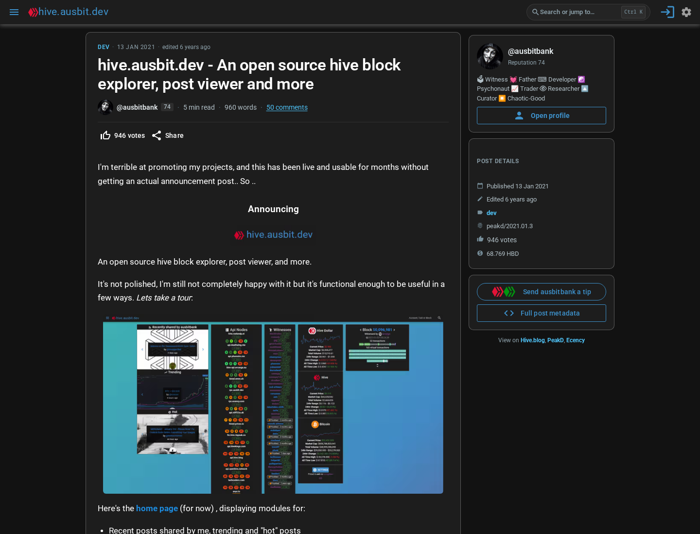
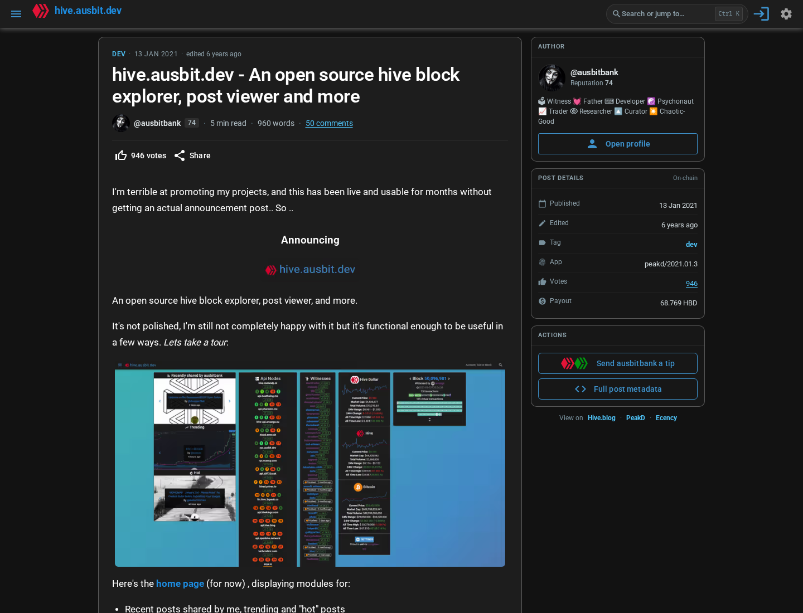
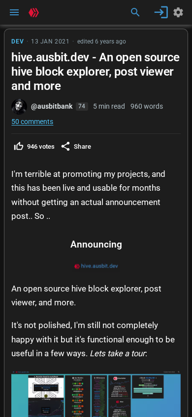
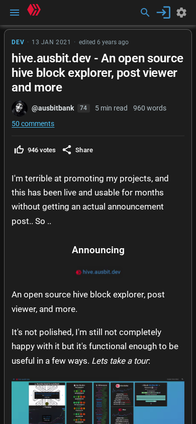
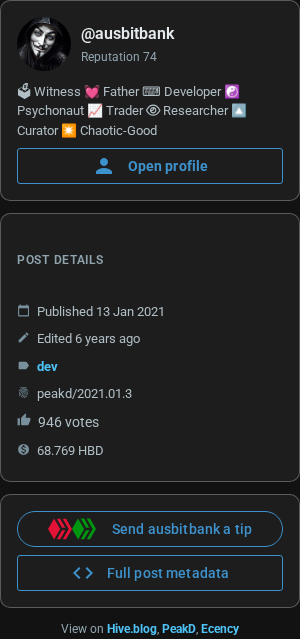
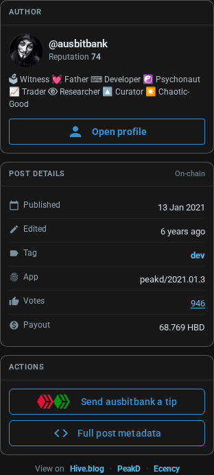
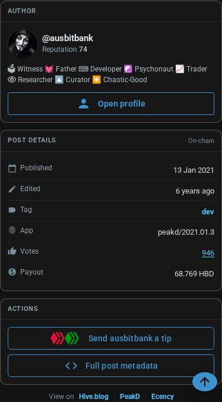

# W27 — UI polish and visual consistency

Date: 2026-11-18
Status: complete — pulled forward ahead of W22–W26

## Scope

A focused visual-consistency pass across the existing W16–W21 surfaces. No
feature workstream was started, no signing or queue authority was changed, and
W28 search remains last.

The pass covered:

- the `MainLayout` header lockup, action group and drawer;
- the `post.vue` author, post-details, tip/action and external-link surfaces,
  including sticky and mobile layout;
- shared UI primitives and card/list rhythm on account, wallet, witness and
  market surfaces;
- spacing, icon-text gaps, button heights, separators, truncation and
  one-character wraps;
- accessibility integration fixes found while auditing the affected routes.

## Header lockup

`src/layouts/MainLayout.vue` previously rendered the hive mark as a font icon
with `max-width: 50%` and no gap, so the title touched the artwork and the two
elements were centred differently. The header now uses:

- a real `` mark at `26px` high (`30.1 × 26` at 1440px) with the title
  hidden below 600px;
- an explicit `10px` icon/title gap and a 1px optical lift on the mark;
- an `inline-flex` brand link with `align-items: center`, a 1.1rem title and
  ellipsis protection;
- a single `.site-toolbar__actions` flex group with a 4px rhythm, 36px targets
  and no ad-hoc `q-ml-md` margin on the account button.

Measured in Chromium: desktop gap **10px**, mark centre-to-title centre **1px**;
390px hides the label and keeps a `27.8 × 24` mark.

### 1440px

| Before | After |
| --- | --- |
|  |  |

### 390px

| Before | After |
| --- | --- |
|  |  |

## Post page and sidebar

The sidebar was rebuilt around the existing profile, post-detail, tip and
metadata content without removing any information:

- **Structure:** author, post details and actions are now three `home-card`
  cards with a shared head/body rhythm. The grid uses explicit
  `article / sidebar / comments` areas, so the sidebar sits between the article
  and the comments on mobile and spans the article and comments rows on desktop.
- **Rhythm:** card heads use `10px 12px`, bodies use `12px`, card gaps use
  `12px`, and facts use 7px rows separated by a 1px subtle rule.
- **Label/value alignment:** facts are a two-column grid (`108px` label,
  flexible value) with right-aligned, tabular values and ellipsis + `title`
  fallback for long community/app names. Vote counts remain a real `<button>`
  that opens the votes dialog.
- **Actions:** tip and metadata buttons are both full width, 38px high and use
  the same 6px radius. The duplicate profile link in the author-card header and
  the vague “Optional” hint were removed.
- **Density:** the author bio is clamped to three lines, the dead space between
  the heading and details is gone, notices are grouped in a bordered list and
  the external front-end links use a compact dot-separated nav.
- **Sticky/mobile:** the sidebar sticks at `64px`, has a viewport-bounded
  `max-height` with contained scrolling, and becomes static below 1024px. At
  641–1023px it uses a two-column card grid; at 640px and below it is a
  stretched single column before the comments.
- **Accessibility:** the page now has exactly one `main` landmark (`q-page`),
  one `h1` and no horizontal overflow. Image-only links in rendered UGC get an
  `aria-label` from the image alt text or destination.

### Post page, 1440px

| Before | After |
| --- | --- |
|  |  |

### Post page, 390px

| Before | After |
| --- | --- |
|  |  |

### Sidebar detail

| Before, 1440px | After, 1440px |
| --- | --- |
|  |  |

## Broader polish audit

- **Spacing:** shared UI primitives and cards moved onto the 4/8px token
  rhythm: `DataTable` head/footer, `FilterBar`, wallet asset cards, witness
  rows and the market snapshot all use matching horizontal padding and row
  density.
- **Buttons:** a 32px global minimum keeps dense and regular buttons from
  collapsing; post actions use 38px targets and the header uses 36px targets.
- **Cards:** account overview stats now stretch to equal height, so the
  effective-HP hint no longer leaves short neighbours; wallet and witness cards
  use matching body padding; market snapshot rows use a consistent 7px rhythm.
- **Drawer:** section headers use a 12/16px rhythm, captions truncate with a
  `title`, items have a 46px minimum height and the footer has its own bordered
  block. The list is now a labelled `navigation` landmark, which also removes
  the axe ARIA-children violation.
- **Truncation:** drawer captions, post author names, post fact values and
  external card names ellipsize instead of wrapping into one-character lines.
  General card copy uses `overflow-wrap: break-word` rather than
  `word-break: break-word`; long UGC still uses `overflow-wrap: anywhere`.
- **Account header:** follow/follower rows use a 4px icon-text gap and 12px
  item spacing; long bios use a 1.55 line height. Mobile tab arrows were removed
  because they overlapped the tab labels; the strip remains swipeable and
  keyboard-scrollable.
- **Landmarks:** nested `<main>` elements on the account and proposal pages were
  converted to labelled `<section>` elements. One page-level `h1` and one
  `main` are now enforced by the E2E suite.
- **External links:** post and account “View on” links keep
  `target="_blank"` and `rel="noopener noreferrer"`.

## Authorities and safety

- No posting or active authority path, queue operation, signing intent or
  broadcast flow was changed.
- Rendered UGC still goes through `renderPostBody` + DOMPurify; the only new
  sanitizer behaviour names image-only links for assistive technology.
- `.postbody` retains `overflow-wrap: anywhere` so long URLs and images cannot
  widen the mobile page.
- External links keep `noopener noreferrer`.

## Verification

- `bun run lint` — clean.
- `bun run test` — **31 files / 245 tests passing** (unchanged from W21).
- `bun run build` — succeeded, including `feed.xml`.
- `bun run test:e2e` — **25 Playwright tests passing** (4.6 minutes).
  - 11 route-level axe tests at 1440px and 390px;
  - 2 new polish tests for the header lockup and post-sidebar order/alignment;
  - the existing queue, browse, login, shortcut, share and PWA coverage.
- Axe: **zero WCAG A/AA violations** at 1440px and 390px for `/`, `/browse`,
  `/blocks`, `/witnesses`, `/proposals`, `/hbd`, `/market`, `/markets`,
  `/@ausbitbank`, `/@ausbitbank/wallet` and the post route, plus the open drawer
  at both widths (24 checks).
- Runtime measurements: one `h1` and one `main` on every audited route, zero
  horizontal overflow, post sidebar top aligned with the article top at 1440px,
  DOM order `article → sidebar → comments` at both widths, and 38px tip and
  metadata buttons.
- Browser smoke: header at 1440/390, post page and sidebar, open drawer,
  account and wallet cards, witness and market surfaces, and a hard reload of
  the post route; no console errors.

## Deploy and live smoke

- Deployed with `./scripts/deploy.sh` (lint, build, feed, prerender, backup,
  upload, activate).
- Backup:
  `hurgenburgen:~/hive-backups/hive.ausbit.dev-20261118T003649Z.tar.gz`
  (`efff0bda514615b7c0774aafeb3ccfa0302cc7b93ed4da67b1b60922eab31576`).
- Activated index hash: `8255b22452c2e1044e31955140f6f1a3b533dbcd9e3693a8c8030eb308d6ef52`.
- Prerendered `/`, `/blocks`, `/browse`, `/witnesses`, `/proposals`, `/hbd`,
  `/market`, `/markets`, `/health`, `/nodes` and `/tax`.
- Live smoke on `https://hive.ausbit.dev` with service workers blocked and a
  fresh browser context:
  - home, post, account, wallet, witnesses and market at 1440px and 390px;
  - one `h1` / one `main` and zero horizontal overflow on every route;
  - zero axe violations on all six routes at both widths and on the open drawer;
  - header gap 10px at 1440px, title hidden and a 24px mark at 390px;
  - post hard reload rendered all three sidebar cards with 38px action buttons;
  - zero console errors.

## What remains next

W27 is complete. The planned performance-first sequence is unchanged and now
starts at **W22 — performance measurement, dashboard and hard-reload startup**,
followed by W23 network/data resilience, W24 runtime/startup polish, W25
governance and community intelligence, W26 drafts and creator workflow, and
W28 unified search and discovery last.
